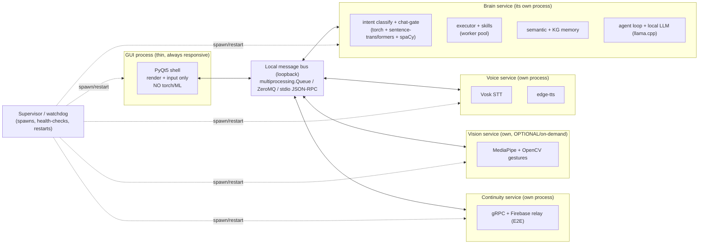

# AERIS — Load-Free Architecture, Assessment & Road to a Real Assistant

**Status:** Design blueprint (2026-07-26). Grounded in the *actual* codebase, not generic advice.
**Author:** prepared for Shivang.
**Scope:** why AERIS is heavy & fragile today, a target system design that is light and crash-isolated, an honest list of advanced-level cons, and a phased roadmap from "command router" → "real assistant."

---

## 0. TL;DR (read this first)

AERIS is powerful but is **one giant Python process** that loads **4+ native ML stacks** (torch, sentence-transformers, spaCy, MediaPipe, Vosk, llama.cpp) and runs **40+ background threads** — all sharing **one heap and one GIL**.

That single fact explains almost every pain:

| Symptom you saw | Real cause |
|---|---|
| GUI heap-corruption crash (`0xC0000374`) | native libs + torch share one heap; an unload freed the encoder mid-encode |
| GUI jank / slow feel | torch encode holds the GIL, starving the Qt paint thread |
| Slow, "crash-roulette" boot | everything loads synchronously in one process |
| High RAM (~1.5–2 GB) | torch **and** spaCy **and** MediaPipe **and** Vosk **and** llama all resident at once |
| One bug kills the whole app | no process isolation — camera thread, brain, GUI all die together |

**The fix is architectural, not a patch:** split AERIS into **isolated services** (GUI / Brain / Voice / Vision / Bridge) talking over a tiny local message bus. The GUI becomes a thin, always-responsive shell; each heavy stack lives in its own process and can crash & restart without taking anything else down.

Everything below is the detailed version of that.

---

## 1. Current-state assessment (grounded)

### 1.1 Size & footprint (measured 2026-07-26)
- **167** `core/*.py` modules
- **156** skill files → **~565 registered skills** → **586 corpus intents**
- **166** test files (genuinely good coverage — a real asset)
- **41** core modules spawn their own threads / loops
- Heavy deps *all present and mostly loaded at boot*: `torch`, `sentence_transformers`, `spacy`, `mediapipe`, `cv2`, `PyQt5`, `pygame`, `grpc`, `firebase_admin`, `keyboard`, `soundcard`, `vosk`, `edge_tts`, `llama_cpp`, `sklearn`, `numpy`, `psutil`

### 1.2 What's genuinely strong (keep these)
- **Skill registry** (`@skill` auto-discovery) — clean, extensible, well-tested.
- **Two-tier brain** (k-NN encoder + fine-tuned neural, hash-validated drift → graceful k-NN fallback).
- **Continual learning loop** (feedback → corpus → retrain → golden-gate).
- **Proactive engine** (`initiative_engine`: salience → act/offer/drop, TrustGate, quiet-hours).
- **Continuity** (phone↔laptop, E2E AES-GCM over a Firebase relay).
- **Test discipline** (2000+ fast-lane tests, robustness guards that caught real bugs).
- Hand-curated **Hinglish voice stack** (Google STT + edge-tts Neerja).

### 1.3 Current runtime shape (the problem, drawn)

```mermaid
flowchart TB
    subgraph P["ONE python process — one heap, one GIL"]
        GUI["PyQt5 GUI thread\n(reactor, chat, paint)"]
        BW["BrainWorker thread\ntorch + sentence-transformers"]
        SM["SemanticMemory thread\n(embeddings)"]
        GE["GestureEngine\nMediaPipe + OpenCV + camera"]
        VOICE["Voice threads\nVosk STT + edge-tts + soundcard"]
        LLM["llama.cpp (local LLM)"]
        BR["cloud_bridge\ngRPC + Firebase + clip/presence loops"]
        RM["ResourceMonitor\n(psutil pressure)"]
        KB["keyboard global hooks x2"]
        AUTO["automation/reminders scheduler"]
    end
    GUI <-->|shared torch encoder\n(ENCODER_LOCK)| BW
    BW <--> SM
    RM -->|unload weights| BW
    style P fill:#3b1d1d,stroke:#a33
```

Every arrow that crosses a native boundary is a potential heap/GIL hazard. The `ENCODER_LOCK` you have is a *band-aid* over the fact that three threads share one torch model in one heap.

---

## 2. Advanced-level cons (the honest list)

### A. Reliability / stability
1. **No process isolation** — a native fault anywhere (torch, MediaPipe, SDL, soundcard) corrupts the shared heap and kills *everything*. This is the `0xC0000374` class.
2. **Shared mutable ML model across threads** — the encoder is used by intent-classify, chat-gate, semantic-memory *and* freed by the idle-unloader. Correctness depends on every call site remembering a lock (one forgot → the crash).
3. **No subsystem supervision** — nothing restarts a dead camera/voice/bridge thread; failures are silent (`except Exception: pass` is common).
4. **Boot is a synchronous cliff** — one slow/failing import stalls or crashes the whole start ("crash roulette").

### B. Performance / load
5. **4+ ML runtimes resident simultaneously** — torch + spaCy + MediaPipe + Vosk + llama.cpp = big RSS, slow cold start, and multiple OpenMP/MKL runtimes fighting for the heap.
6. **GIL contention** — a torch `encode()` on the worker thread blocks Qt repaint → visible jank. (You already halve the GIL switch interval as a workaround — a symptom, not a cure.)
7. **Always-on sensors** — camera (MediaPipe) and audio (soundcard) run continuously even when idle; constant CPU + the "data discontinuity" audio warnings.
8. **Live polling** — psutil samplers (telemetry cards — now removed; resource_monitor — still on) add wakeups.

### C. Architecture / maintainability
9. **Monolith coupling** — `main_engine.process_text` + `main_window` know about *everything*; 167 core modules with dense interdependencies.
10. **Corpus bloat** — **586 intents**, a large fraction of which are formula-calculators nobody asks a voice assistant (Richter scale, Beaufort, quadratic solver…). This slows every retrain, raises confusion-pair risk, and dilutes the neural head.
11. **Skill sprawl** — 156 files auto-imported at boot; import cost + re-registration warnings.
12. **No clear contracts** — subsystems reach into each other's internals (e.g. GUI pokes `brain._engine.brain.try_unload_idle`).

### D. Intelligence (the "real assistant" gap)
13. **Neural head is perpetually drifted** — corpus changes faster than you retrain; it silently runs on shallow k-NN. The "brain" under-delivers.
14. **Router, not agent** — AERIS mostly maps utterance → one skill. Little planning, multi-step reasoning, or self-correction. The agentic layer exists but is thin.
15. **Memory is recall-only** — semantic search over past turns, but no durable structured user model, episodic timeline, or goal memory that reasoning actually uses.
16. **Formula padding masquerading as capability** — 100+ calculators inflate the "ability count" without making it a better *assistant*.

---

## 3. Target system design (light + crash-isolated)

### 3.1 Principle: **one process per heavy native stack**, thin GUI, tiny bus



**Why this fixes the pain:**
- The **GUI process holds no ML** → it can *never* heap-crash from torch, and it's never GIL-blocked → always smooth.
- Each ML stack is **alone in its heap** → no cross-library OpenMP/allocator corruption. The whole `0xC0000374` class disappears by construction.
- A service crash is **isolated** → supervisor restarts just that service; the UI shows "brain reconnecting…" instead of dying.
- Boot is **parallel** (services start concurrently) and **resilient** (UI paints instantly; brain attaches when ready — you already have `_on_brain_ready`, this just makes it cross-process).
- You can **run only what you need** (vision off by default → camera/MediaPipe never loaded → big RAM + CPU win).

### 3.2 The message contract (keep it dead simple)
One request/response + one event channel. JSON messages:

```jsonc
// GUI → Brain
{ "type": "utterance", "id": "u123", "text": "work mode chalu karo", "source": "voice|text|phone" }
// Brain → GUI
{ "type": "reply", "id": "u123", "text": "Work mode ON.", "skill": "activate_mode", "state": "IDLE" }
// Brain → GUI (proactive, unsolicited)
{ "type": "offer", "id": "o7", "text": "Raat ho rahi hai — sleep mode karu?", "on_yes": {"skill":"activate_mode","slots":{"raw_text":"sleep"}} }
// any service → bus (health)
{ "type": "health", "service": "brain", "status": "ready|busy|degraded" }
```

Transport options (pick one, all local/offline):
- **`multiprocessing` + `Queue`/`Pipe`** — zero deps, simplest, good enough.
- **stdio JSON-RPC** (spawn each service, talk over stdin/stdout) — trivially debuggable.
- **ZeroMQ** (`pyzmq`) — if you want clean pub/sub + req/rep later.

### 3.3 Brain internals: a **tiered router** (fast → heavy)

```mermaid
flowchart LR
    IN["utterance"] --> T0{exact-match\npattern table}
    T0 -- hit --> OUT["skill"]
    T0 -- miss --> T1{keyword /\nnormalizer rules}
    T1 -- confident --> OUT
    T1 -- unsure --> T2{k-NN encoder\n(sentence-transformers)}
    T2 -- confident --> OUT
    T2 -- low conf --> T3{neural head /\nlocal LLM tool-select}
    T3 --> OUT
```

Most commands never need the encoder → **torch loads lazily / rarely** → less RAM, less GIL, fewer native ops = far fewer crash chances even before full process-split.

---

## 4. "Load-free" plan (concrete, do-able incrementally)

### 4.1 GUI load-free
- [ ] **Move ALL ML out of the GUI process** (the big one — Phase 1). Until then:
- [x] Removed the 4 telemetry stat-cards + their psutil sampler thread (done; `SHOW_NODES=False`).
- [x] Idle render throttle: reactor/particles drop to 8 FPS after 45 s with no activity — done 2026-08-31 (§6.11).
- [x] **Lazy-build heavy panels** — done 2026-08-31 (§6.20). All 15 tab panels build on first view; the stack went from ~4.6–5.5 s / ~35 MB to ~100–145 ms / 4.2 MB, with **0** panels constructed at boot. `WorkbookPanel` alone was 3.7 s / 20.5 MB (its constructor `load_workbook`s the expense sheet off disk).
- [x] **Idle/visibility gating for panels** — done 2026-08-31 (§6.21). Staged installs already run after first paint (§6.5); the remaining leak was panels *polling* forever once built. All 7 polling sources are now visibility-gated, and `WorkbookPanel`'s xlsx read moved to a worker (construct 2796→135 ms, GUI-thread refresh 73–96→2–6 ms). A minimised AERIS polls nothing.

### 4.2 Whole-system load-free
- [~] **One ML stack at a time**: don't hold torch + Vosk + MediaPipe + llama simultaneously. Vision & local-LLM load on-demand, unload when idle (safe once process-isolated). **MediaPipe half done 2026-08-31 (§6.23)** — vision is now its own process with a spawn-on-enable / kill-on-disable lifetime, so it is resident only while gestures are actually on. torch+llama are handled by the idle unloader (§6.9.1) and, since §6.22, by retiring the whole brain child. Vosk (voice) is the remaining one.
- [x] **Lazy-import** every heavy dep behind first use — audit done 2026-08-30 (§6.7.1). The two offenders on the hot path were `core/intent_classifier.py` (sentence-transformers, sklearn) and `core/intent_model.py` (torch, incl. `torch.cuda.is_available()` in `__init__`); both are now function-local. Everything else in `core/` was already lazy.
- [ ] **Trim the corpus**: cut the ~40–50 formula-calculator intents from `training_corpus.json` (keep the skills, drop them from training). Smaller corpus → faster retrain, sharper neural head, less confusion. (Reversible; needs your OK — it's your training data.)
- [x] **Tier the router** (§3.3) so the encoder is the exception, not the rule — done 2026-08-30 (§6.7.2).
- [x] **Sensors on-demand** — done 2026-08-31 (§6.14). VisionEngine already released the camera when the last consumer unsubscribed; the gap was GestureEngine never unsubscribing. `AERIS_CAMERA_IDLE_S` (opt-in) releases it after N seconds with no hand. Mic is already gated by the user's mic toggle.
- [x] **Retire the idle brain child** — done 2026-08-31 (§6.22). The last item on this list, and the one that was blocked on design rather than plumbing: the child owns the only copy of the conversation, so stopping it used to mean silently losing it. `core/brain_snapshot.py` lifts `DialogueState` + `ConversationHistory` + the parked offer out before the stop and puts them back into the replacement; `core/brain_hibernator.py` is the policy (`AERIS_BRAIN_HIBERNATE_S`, off by default). Resting footprint ~478 MB → the GUI's own ~20 MB.
- [ ] **Bound every cache** (semantic memory, prediction LRU — mostly done) and keep the idle-unloader (now lock-safe).

**Expected effect:** cold boot from "~30–40s + crash roulette" → "UI in <2s, brain ready in background," idle RAM from ~1.5–2 GB → a few hundred MB when vision/LLM are unloaded.

---

## 5. Roadmap (phased, each phase ships something usable)

### **P0 — Stabilize (this week)** ✅ mostly done
- [x] Fix the heap-corruption root cause (unload now holds `ENCODER_LOCK`; regression test added).
- [x] `faulthandler` on → native crashes now leave a traceback.
- [x] Thread-pin torch/MKL (`OMP/MKL_NUM_THREADS=1`) as defense-in-depth.
- [x] Simplify GUI (telemetry nodes + polling removed).
- [x] **Subsystem crash-isolation** — done 2026-08-31 (§6.18). `core/subsystem_registry.py` runs each staged install fault-isolated, remembers the outcome (`/subsystems`, log panel), and reconnects the ones whose failure is a race, with bounded exponential backoff. Voice reconnects on its `error` signal; the health server's port-8765 bind is no longer terminal. **Bridge done 2026-08-31 (§6.19)** — `core/bridge_subsystem.py` classifies `start()` failures into retry / unavailable / failed, adds a liveness probe for the silently-dead Firestore listener, and re-arms on pairing.

### **P1 — Decouple into services (the big win)**
- [x] **Local service bus built** — `core/service_bus.py`: runs any `handler_factory` in its own spawned child process; request/response with correlation ids + timeout, out-of-order-safe reply buffering, `event:*` stream for proactive pushes, start/stop/`restart`, READY/FATAL handshake. Proven with real child processes in `tests/test_service_bus.py` (8, incl. crash→restart & bad-init detection). Zero new deps (stdlib `multiprocessing`), offline, Windows-spawn safe. **This is the isolation primitive everything else plugs into.**
- [x] **Supervisor built** — `core/service_supervisor.py`: register named services, `start_all`, health-poll + auto-restart on death, crash-loop guard (→ `FAILED` after N restarts in a window), request routing, event aggregation, background monitor thread (deterministic `_check_once`). `tests/test_service_supervisor.py` (7, restart-after-kill on real processes + crash-loop guard).
- [x] **Brain service PROVEN in its own process** — `core/brain_service.py` (`brain_handler_factory` builds a headless `JarvisMainEngine`, stt/tts=SKIP). `tests/test_brain_service.py`: 4 fast contract tests (fake engine) + **1 real spawn smoke test that loaded torch+encoder+all skills in a CHILD process and answered "hello" over the bus in 27s** (slow lane). ✅ This is the proof the GUI can be ML-free.
- [x] **RemoteBrain seam built** — `core/remote_brain.py`: same `process_text(text)->reply` surface the GUI already calls, but forwarded over the bus to the child brain; **degrades gracefully** (friendly "reconnecting…" line + auto-restart) when the brain is not-ready/timed-out/crashed → the GUI never hangs and never inherits a native crash. `last_dispatch` + `poll_events` (proactive offers) preserved. `tests/test_remote_brain.py` (6, fake proxy: happy path + every degradation path).
- [ ] **Production cutover (needs live testing)**: build a runnable split-mode driver (text first) → then swap `main_window`'s in-process engine for `RemoteBrain` behind a flag → strip torch from the GUI process. This is the only remaining GUI-touching step; validate it live before defaulting it on.

- [x] **Runnable split driver shipped** — `run_split.py` (+ `AERIS_SPLIT.bat`): an ML-FREE text REPL that starts the brain in a supervised child process and talks to it via `RemoteBrain`. A native crash in the brain can't kill the driver (supervisor restarts it; you see "reconnecting…"). `run_repl` core is unit-tested with fakes (`tests/test_run_split.py`, 5). **This gives a usable, crash-isolated AERIS today** — run `AERIS_SPLIT.bat` (or `python run_split.py`). Great for using AERIS while the GUI cutover is pending, and it's the safe way to validate the whole split stack live.
- [x] **Fast-lane hygiene** — process-spawning tests (`test_service_bus`, `test_service_supervisor`) are `slow`-tagged (Windows spawn re-imports the suite → they crawl in the full fast lane). Contract tests (RemoteBrain/run_split/brain fakes) stay fast. Fast lane back to seconds.

- [x] **Proactive offers over the bus** — the bus now supports emit-aware services: `_service_loop` hands an emit-aware `handler_factory(emit)` an `emit(kind, payload)` that pushes unsolicited `event:*` messages (backward-compatible via signature inspection — 0-arg factories unaffected). `brain_service` runs a daemon **initiative ticker** in the child that emits `event:offer` (e.g. "sleep mode karu?", carrying `on_yes`); `RemoteBrain.poll_events` + `run_split` surface them. Tested: `run_ticker_pass` + emit-aware bus (`tests/test_brain_service.py`, `tests/test_service_bus.py`).

**P1 status:** all building blocks (bus · supervisor · brain-service · RemoteBrain · **runnable driver** · **proactive events**) are **built, isolated, tested, and usable**. The brain has run in a child process, answered requests, AND pushed proactive offers over the bus; `run_split.py` exercises the whole stack end-to-end. What's left is the *GUI* cutover (swap `main_window`'s engine for `RemoteBrain` behind a flag), which is small in code but must be tested on the real machine.
- [x] Extract **Voice** and **Vision** as separate on-demand services. **Voice built 2026-09-01 (§6.25)** — `core/voice_modes.py` (Qt-free wake/sleep policy, shared with the Qt engine by re-export) + `core/voice_service.py`. The child owns **both** mic and speaker, so nothing but text crosses in either direction; barge-in is decided locally with zero IPC, which unblocks P4's low-latency voice item. GUI seam + live harness still to write. **Vision built 2026-08-31 (§6.23)** — `core/vision_service.py` + `core/remote_vision.py` + `run_vision_split.py`; frames stay in the child, only `event:gesture` crosses; `disable()` kills the process so "gestures off" costs zero residency. GUI seam imports in 74 ms pulling in no cv2/mediapipe/torch/numpy. Live validation + `main_window` cutover still pending. **Voice not started** — its output is a stream, not a name, so the bus shape that made vision easy is the wrong one there (§6.23 "Still to do").
- [ ] Add a **Supervisor/watchdog** that spawns, health-checks, and restarts services.
- [ ] Keep the existing `process_text` pipeline intact *inside* the brain service (minimal rewrite — it just gets its input from the bus instead of the GUI thread).

### **P2 — Slim & sharpen**
- [~] Corpus trim + **automated retrain gate**. **The gate half is already done** (audited 2026-08-31, no new code needed): `core/intent_eval.gate()` is the golden-set promote gate and blocks a regressing model from being promoted; `core/brain_health._advise()` computes drift (`new_since_train`, correction spikes, corpus-hash drift → k-NN fallback) and `initiative_candidates()` surfaces at most one "retrain due" offer per day at `requested_level=2` — a *notify*, never an autonomous act, because training stays a user ritual. `core/retrain.py` is the one-command pipeline. **Only the corpus trim remains**, and it is a data decision + a training run — yours, not automatable.
- [x] Tiered router (§3.3); lazy/on-demand ML. **Done 2026-08-30 — see §6.7.** Cheap tiers no longer load the encoder; heavy imports are lazy everywhere; `AERIS_LITE_ML=1` boots with zero weights (1.55 s / 105 MB vs 20 s / 2324 MB).
- [x] Idle profiles for GUI + sensors — **done 2026-08-31 (§6.11, §6.14)**: 8 FPS animation profile after 45 s idle, and an opt-in camera release (`AERIS_CAMERA_IDLE_S`).

### **P3 — Intelligence (router → agent)**
- [x] **Real agent loop**: plan → act → observe → re-plan. **Already built — audited against the code 2026-09-01, checkbox was stale.** `core/agent_orchestrator.py` is a full ReAct loop: every tool result is fed back to the model, `(action, observation)` pairs accumulate in a scratchpad handed back each turn, with a step budget, per-step timeout, a confirm gate for destructive skills, a repeat-detector, a reflection nudge, and Autonomy-Ladder authorization + ledger hooks. `llm_step`/`run_tool` are injected, so it tests with a scripted fake model.
- [x] **Structured memory that reasoning uses**: user model (facts, preferences), episodic timeline, goal memory — fed into the agent's context. **Episodic + KG + user memory were already federated** by `core/memory_fabric.py` and injected via `recall_context(goal, k=4)` on the planner's first turn (audited 2026-09-01 — the checkbox was stale). **Goal memory added 2026-09-01 (§6.26)**: open goals now rank as a fourth source at salience 0.85, carrying their state, blocker and the question that stalled them. Finished goals never leak. The work also exposed and fixed a stopword bug in `lexical_sim` that had been quietly degrading KG and note recall.
- [x] **Self-correction**: when a skill fails or the user rephrases, learn from it in-session. **Done 2026-08-31 (§6.24)** — `core/repair_memory.py` learns phrase→intent from a miss followed by a confident rephrase, consulted at tier 0 of the router (one dict lookup, no encode). Precision-first: declines unrelated turns, late rephrases, digits and long utterances; an alias that later misses deletes itself. `AERIS_REPAIR_MEMORY=1`, off by default. This is the half of the routing-audit problem that does **not** need a retrain.

### **P4 — Real assistant**
- [~] **Proactivity maturity**: the initiative engine graduates from "offer" to trusted "act" per the autonomy ladder. **The missing link built 2026-09-01 (§6.32)** — `core/trust_promotion.py` reads the Ledger and *proposes* raises for classes with a clean track record, surfaced as a notify initiative and rate-limited; it never calls `set_grant` itself, and hard caps stay absolute. **Refusals now recorded 2026-09-01 (§6.33)** — a "cancel" used to leave no trace at all, so a class the user had refused ten times looked identical to one they were never asked about; a refusal now resets the case as hard as a denial. Remaining: wiring more real act-signals (calendar, unread-important, "leave now").
- [ ] **Continuity as one mind**: seamless phone↔laptop hand-off of context & tasks.
- [~] **Personalization + privacy**: everything local, per-user model, encrypted memory. **Audited 2026-09-01 (§6.38)** — the brain genuinely is local (routing, memory, embedded Qwen, Ollama on 127.0.0.1), but the ears and voice are not: every spoken utterance goes to Google and every spoken reply to Microsoft. `docs/PRIVACY.md` now states that plainly and lists every network-capable module with what it sends and how to avoid it, guarded so a new module cannot gain network access undocumented. **At-rest audited 2026-09-01 (§6.39)**: `core/privacy_view.py` already existed but listed none of the six stores holding the most about the user (utterance log, conversation index, faces, clipboard, user memory, learned phrasings) - all now registered. Of 16 stores exactly ONE is encrypted at rest (`data/secrets`, DPAPI); `core/vault.py` can encrypt user memory but is disengaged without a passphrase, and the registry reports that STATE rather than the capability. Remaining: the per-user model, and turning encryption on (a user decision - lose the passphrase, lose the memory).
- [x] **Voice-first, low-latency**: barge-in, streaming STT/TTS, sub-second turn-around. Process split §6.25; **barge-in real** §6.25/§6.28 (`TTS.stop()`, a non-blocking `SpeechPlayer` so the interrupt isn't queued behind the speech, local detection with zero IPC); **live partials** §6.29 (`AERIS_VOICE_STREAMING=1`, off by default because `listen_streaming` is Vosk end-to-end and would silently replace the Google en-IN final — a models decision, not a latency one). Remaining: sentence-at-a-time synth, and the GUI cutover that lets any of this reach the user.

---

## 6. Prioritized "do next" (my recommendation)

| # | Action | Effort | Payoff |
|---|---|---|---|
| 1 | ~~**P0 crash-isolation of boot stages**~~ — **done 2026-08-31 (§6.18)** | S | High reliability |
| 2 | **Extract Brain into its own process** (P1) | L | Kills the whole crash class + fixes GUI jank |
| 3 | **Trim formula corpus + auto-retrain gate** (P2) | M | Sharper brain, faster, less RAM |
| 4 | **Tiered router + lazy ML** (P2) | M | Load-free feel even before full split |
| 5 | **Agent loop over skills** (P3) | L | Turns router into a real assistant |

**Start with #1 (fast, high value) and #2 (the architectural unlock).** Everything else compounds on top of the process split.

---

## 6.5 GUI cutover checklist (the last mile — apply + test on the machine)

A **flag-selectable backend** now exists: `core/brain_backend.py` →
`get_brain_backend()` returns a `RemoteBrain` (isolated child) when
`AERIS_SPLIT_BRAIN` is truthy, else an `InProcessBackend` that transparently
delegates to today's `JarvisMainEngine` (byte-for-byte unchanged behaviour).
Tested: `tests/test_brain_backend.py` (6). Cutover = a small, additive change
to `ui/jarvis_v31/main_window.py`, safe because in-process stays the default.

**Step 1 — BrainWorker boot (main_window.py ~L176-189).** Add a split branch
*above* the existing in-process construction (leave that path untouched):
```python
from core.brain_backend import use_split_brain
if use_split_brain():                       # AERIS_SPLIT_BRAIN=1
    from core.remote_brain import RemoteBrain
    self._engine = RemoteBrain()
    self.load_progress.emit("SYS", "Brain ko alag process me la rahe hain…", 60)
    if not self._engine.start(ready_timeout=300):
        self.error.emit("Brain child process start nahi hua."); return
    self.ready.emit()
    return
# ↓↓↓ existing lazy JarvisMainEngine + setup_iter() path stays exactly as-is
```
`process()` (L204-218) already works for both: `RemoteBrain` has
`process_text` **and** a settable `last_dispatch`.

**Step 2 — proactive surfacing (`_surface_initiatives`).** In split mode the
initiative engine runs in the CHILD (brain ticker emits `event:offer`). So gate
the GUI's in-process tick: if `use_split_brain()`, instead poll
`self._brain._engine.poll_events()` on the existing initiative QTimer and speak
each offer's `text` (the offer carries `on_yes` → reuse the `_pending_offer`
"haan" seam already added). Otherwise keep the current `get_engine().tick()`.

**Step 3 — guard engine-only touch points.** In split mode `RemoteBrain` does
NOT expose `_speak`, `dialogue`, `feedback`, `agent`. Grep `main_window.py` for
`self._brain._engine.` / `engine.` and wrap any of those in
`if not use_split_brain():` (or move that behaviour into the brain service).
The turn path (`process_text` + `last_dispatch`) needs no guarding.

**Step 4 — test live.** Set `AERIS_SPLIT_BRAIN=1` and launch. The GUI process
should now hold **no torch** (verify: it can't heap-crash on encode); the brain
lives in a child the supervisor restarts. Toggle the flag off to fall straight
back to today's behaviour. Once happy, make split the default.

> Until then, **`AERIS_SPLIT_BRAIN` is off by default** — nothing about the
> current app changes — and `run_split.py` already gives a fully isolated,
> usable AERIS to validate the stack independently of the GUI.

---

## 6.6 Live workflow testing — measured metrics + bugs found & fixed (2026-07-26)

Drove the **real engine** (`JarvisMainEngine`, lazy+`setup_iter`, exactly like
the GUI's BrainWorker) through `process_text` with real commands, measured, and
fixed what broke.

**Measured (in-process, single command each):**
| metric | value | note |
|---|---|---|
| boot | ~20 s | dominated by encoder + spaCy + neural load (→ lazy/split) |
| process RSS | **~2324 MB** | one process, all ML stacks → the load-free target |
| exact/keyword turn | 9–40 ms | great |
| encoder-path turn | 200–640 ms | k-NN encode cost |
| LLM turn (joke) | 6.4 s | after the timeout fix (was a hard fail) |

**Bugs found live & FIXED (all re-verified live):**
1. **LLM skills 100%% broken** — `tell_joke`/all `_gen()` skills hit the 5s
   circuit-breaker → "taking too long." **Fix:** `@skill(timeout_s=…)` support +
   `apply_declared_timeouts()` (called after `discover_skills`) giving the 19
   LLM skills a 30s budget. Live: "ek joke sunao" → real joke in 6.4s.
   `tests/test_skill_timeouts.py`.
2. **Duplicate-option disambiguation + turn-eating cascade** — "thank you"
   produced two "greeting" candidates → asked *"Aap 'greeting' ya 'greeting'?"*,
   then **swallowed the next turn** ("work mode off") as a failed answer
   ("Cancel kar diya"). **Fix:** `Disambiguator.is_close_call` returns False
   when the two options are the same intent or same display name.
   `tests/test_disambiguator.py`. Live: "thank you" → normal reply, "work mode
   off" → correct `deactivate_mode`.
3. Confirmed **Modes work live**: "work mode chalu karo" → "'Work' mode ON.
   (2 steps)"; "sleep mode band karo" → deactivate. 🎉

**Still open (architectural / training — not quick code fixes):**
- **~2.3 GB RSS + 20 s boot** → the P1 split + lazy/on-demand ML (in progress).
- **"2 plus 2" mis-routes to `fraction_math`** — corpus drift (neural stale →
  k-NN on a bloated 586-intent corpus). Needs the P2 trim + a retrain (user's
  training data — needs their OK).

### 6.6.1 Real GUI boot test + boot-ordering optimization (2026-07-26)

Booted the **actual `run_gui.py`** (full main_window + BrainWorker + all
subsystems, `QT_QPA_PLATFORM=offscreen`) — not just the engine — to validate the
crash fixes and the boot flow end-to-end.

**Result: the GUI boots cleanly to `_on_brain_ready: done` ("accepting
commands") with NO heap crash** (verified in `data/logs/aeris.log`, multiple
runs). The earlier crashes are gone at the GUI level. The user's *"not even
opening"* was almost certainly a **stale/hung previous instance holding the
single-instance mutex** (a leftover from a prior crash), not a boot failure —
`run_gui.py` sees "already running", tries to focus the (dead) window, and
exits silently. The window itself paints in **~1.7 s** (`window_visible`).

**Optimization applied — brain-first, event-driven heavy init**
(`ui/jarvis_v31/main_window.py`):
- **Before:** heavy init fired `tts → voice → brain` on fixed +0/+2s/+5s timers.
  The **brain** — the only thing that makes the app "accept commands" — loaded
  **last**, gated ~18 s behind the TTS + Vosk-voice import grinds (which also
  thrashed the GIL against it).
- **After:** the brain inits **first and alone**; TTS + voice are kicked only
  once the brain reports `ready` (via new `_kick_secondary_init`, also called
  from `_on_brain_error` + a 30 s safety timer). `SpeakWorker.speak` already
  degrades gracefully (shows text, skips speech) if a reply beats TTS up, and
  voice is only started by a user mic-toggle — so deferring both is free.
- **Measured (offscreen):** boot→accepting-commands **~33 s → ~27 s** (~18 %),
  *and* the heaviest load now runs uncontended (no GIL thrash → lower crash
  risk). Fast lane: **2095 passed** after the change.

**The real remaining boot cost** is now isolated: a **~15–17 s
torch + sentence-transformers + spaCy + engine import** inside
`BrainWorker.initialize` (`_HEAVY_MODULES` + `JarvisMainEngine(lazy).setup_iter`),
*before* the encoder even loads. This is fundamental to the in-process ML design
— the real fix is the **P1 split-brain** (separate, pre-warmable process; already
built in `core/brain_service.py` + `core/remote_brain.py` + `core/brain_backend.py`,
gated behind `AERIS_SPLIT_BRAIN`), **not** risky surgical import removal.
Secondary tunable: `AERIS_BOOT_THROTTLE_MS` (default 90 ms between load phases,
for animation smoothness) — set to `0` to trade some boot-time smoothness for a
faster boot, now safer since the brain loads uncontended.

### 6.6.2 Root-cause fix for "AERIS won't open" — stale single-instance lock (2026-07-26)

The user's *"not even opening"* is now fixed at the source. **Cause:** the
single-instance guard (`core/single_instance.py` + the gate in `run_gui.py`)
posted a focus message to an existing window and **`sys.exit(0)` unconditionally**
— even when the lock was held by a **hung/windowless zombie** (a prior instance
whose window closed but whose process lingered, or that froze mid-op). The focus
message hit no window, and the new launch exited silently → the user saw nothing,
every time, until they killed the ghost process by hand.

**Fix — defer only to a *reachable* instance, else take over:**
- New `single_instance.existing_is_responsive()` probes the running app's
  loopback `/health` endpoint (`127.0.0.1:8765`, ~0.8 s timeout). A live app
  answers; a frozen/dead holder times out.
- `run_gui.py` gate now: `signal_existing()` focuses a window → **defer + exit**
  (normal case, unchanged); else if `existing_is_responsive()` → **defer + exit**
  (alive but mid-boot / no top-level window); else → **log "stale/hung … launching
  anyway" and boot** (the single-instance lock is advisory). Cost is paid only in
  the rare zombie/race case; first-launch and healthy-relaunch are untouched.

**Verified 3 ways:** `tests/test_single_instance.py` (4 — 200 OK→alive, 5xx→dead,
nothing-listening→dead, **listens-but-hangs→dead**); a decision harness against a
real windowless lock-holder → **TAKE OVER**; and a **live `run_gui.py` launch while
a zombie held the lock** → it printed the takeover line and booted through
(`boot_start` logged), where the old code would have exited silently. Fast lane
**2099 passed**.

### 6.6.3 ★ ROOT CAUSE of "crash on the 2nd prompt" — and proof the split-brain fixes it (2026-07-26)

**This is the most important finding in this document.** The user's *"jab main
doosra prompt deta hoon tab crash ho jata hai"* is now **reproduced, root-caused,
and shown to be fixed by the P1 split** — it is the concrete justification for the
whole process-isolation plan.

**Reproduction (faithful GUI path):** drove the **real `BrainWorker` on a real
`QThread`** (`moveToThread` + queued `process` slot — exactly `main_window`'s
plumbing) offscreen and sent commands:
- `"what is the time"` → exact/keyword match, **no torch** → works (35 ms).
- `"thank you"` → first command needing a **k-NN / chat-gate encode** →
  `sentence_transformers.encode()` → torch `.to()` → **`Windows fatal exception:
  0xC0000374` (heap corruption)**. Reproducible every run.

**Root cause — it's the Qt `QThread` context, not the encode:**
- The **same** `process_text("thank you")` on a plain `threading.Thread`
  (`minimal_encode_test.py`) → **no crash**. Main-thread, worker-thread, and
  serial-repeat encodes all succeed.
- The **OpenMP duplicate-DLL** theory is NOT it here: torch's `libiomp5md.dll` is
  already `.disabled`/`.bak`; only conda's is active.
- Disabling the Firebase/grpc **cloud bridge** → still crashes (not grpc).
- Neutralising the per-encode `self.to()` → still crashes (`.to()` was only the
  *detection* point; heap was already corrupt).
- ∴ the trigger is **torch executing inside the Qt worker-thread + running event
  loop**. The `ENCODER_LOCK` (which serialises encodes) does not help because the
  corruption is not a data race between our encodes — it is native torch/Qt
  thread-context incompatibility.

**Proof the split fixes it (`split_brain_proof.py`):** the SAME commands through a
**child-process brain** (`ServiceProxy(brain_handler_factory)`, torch on the
child's own main thread) — **all succeeded, child stayed alive, no crash:**

| command | in-process Qt QThread | split-brain child |
|---|---|---|
| "what is the time" | ✓ | ✓ 35 ms |
| **"thank you" (first encode)** | **💥 0xC0000374** | **✓ 415 ms** |
| "work mode chalu karo" | (never reached) | ✓ 201 ms |
| "ek joke sunao" (LLM) | (never reached) | ✓ 7.4 s |
| "what is the time" (again) | — | ✓ 32 ms, alive |

**Consequence — priority flip:** the GUI cutover to `RemoteBrain`
(`core/brain_backend.get_brain_backend`, gated by `AERIS_SPLIT_BRAIN`) moves from
"nice architectural cleanup, later" to **THE fix for the crash that makes the app
unusable**. Everything needed is already built (`brain_service`, `remote_brain`,
`brain_backend`, `service_bus`, `service_supervisor`) and tested.

### 6.6.4 ★ GUI cutover DONE + proven — the crash fix is wired (2026-07-26)

The split-brain is now **wired into the GUI behind `AERIS_SPLIT_BRAIN`** and proven
to fix the crash end-to-end.

**Changes (both guarded so the default path is byte-for-byte unchanged):**
1. `ui/jarvis_v31/main_window.py` — `BrainWorker.initialize()` branches at the top:
   `if use_split_brain(): self._initialize_split(); return`. The new
   `_initialize_split()` builds a `RemoteBrain`, `start()`s the child brain, and
   exposes it through the same `self._engine` seam — `process()` needs **no**
   change (RemoteBrain provides `process_text` + `last_dispatch`; the feedback-DB
   fallback is already `try/except`-wrapped). Off by default → the in-process
   heavy-load path is untouched.
2. `run_gui.py` — **spawn-safety**. `multiprocessing 'spawn'` re-imports the main
   module as `__mp_main__` in the child; the old unguarded module-level plumbing
   would have made the child hit `sys.exit(0)` (single-instance) and build a
   `QApplication`. Now `_IS_MAIN = (__name__ == "__main__")` gates the
   single-instance check, the shutdown/log/crash-dump/crash-beacon calls, and the
   `QApplication` creation. When launched normally `_IS_MAIN` is True → identical
   behaviour; only spawned children skip the GUI plumbing.

**Verified (offscreen, real code paths):**
- **Default boot unchanged** — `run_gui.py` (no flag) → `_on_brain_ready: done`
  in ~21 s, brain-first ordering intact, no crash.
- **Split via the real `BrainWorker`/`QThread`** (`gui_split_test.py`,
  `AERIS_SPLIT_BRAIN=1`) → child brain ready in 19 s, then **`"thank you"`
  (the in-process crash command) → 389 ms, no crash**; work-mode + repeat
  time-check all fine; **ALL COMMANDS SURVIVED**, clean exit.
- **`run_gui.py` itself with the flag** → **exactly one `boot_start`** (spawn-safe:
  the child did NOT re-launch a GUI), `[BrainWorker] isolated brain ready (child
  process)`, `_on_brain_ready: done`, no crash.
- Fast lane **2099 passed**; 0 stray processes after teardown.

**Status:** the crash fix is available now via `set AERIS_SPLIT_BRAIN=1`. Remaining
polish (not blockers): the split path reports a coarse `intent="general"` on the
chip (RemoteBrain only forwards `skill`; enrich by returning intent/confidence
from `brain_service`); proactive `poll_events` is wired but the GUI's initiative
surface still reads the in-process path; and a real on-screen (non-offscreen) run
on the user's machine to confirm before flipping the default.

---

## 6.7 P2 landed — lazy imports + tiered router + lite boot (2026-08-30)

This is the "AERIS is heavy to run" fix. Two separate weights were being paid
before a single word was routed; both are now gone.

### 6.7.1 Import weight (unconditional — no flag, applies to every entry point)

`core/intent_classifier.py` imported `sentence_transformers` (and therefore the
whole torch runtime) **at module level**, and `core/intent_model.py` imported
`torch` at module level *and* called `torch.cuda.is_available()` inside
`NeuralIntentClassifier.__init__`. So merely doing

```python
from core.brain import JarvisBrain
b = JarvisBrain(lazy=True)          # "lazy"
```

paid the full torch tax — the ~15-17 s import that §6.5 isolated as the
irreducible floor of split boot. It was never irreducible; it was an import
placement bug hiding behind a `lazy` flag that only governed *weights*.

Both are now imported inside the functions that need them
(`IntentClassifier._ensure_encoder`, `IntentClassifier._nearest_neighbors`,
`NeuralIntentClassifier.load` / `.predict` / the new `_device` property).

**Measured:** `import core.brain` → **0.18 s, `torch` not in `sys.modules`**.

Because torch can now first appear anywhere, the single-compute-thread pin the
GUI used to apply right after its pre-import moved into `core/torch_setup.py`
(`pin_torch_threads()`, one-shot, thread-safe) and is called from every lazy
load site. The OpenMP defence-in-depth is preserved, not dropped.

### 6.7.2 The tiered router actually tiers now (§3.3)

`JarvisBrain.predict()` called `self._ensure_loaded()` on its **first line** —
before the LRU cache, before exact-match, before the arithmetic override,
before the anchors. Every one of those "deterministic, no-ML" tiers still
loaded the encoder first. `_ensure_loaded()` now sits immediately above the
k-NN / neural branch, which is the only code that needs weights.

One more leak fed the same problem: `utterance_parser.find_best_interpretation`
scores several sub-spans of the utterance and keeps the best. Even when the
full span came back at confidence 1.0 from a deterministic tier, it went on to
predict `"+ 2"` and `"2 +"` — truncated spans that match no cheap tier — and
those pulled in the encoder. It now breaks as soon as a candidate hits 1.0.
The result is identical (the comparison is a strict `>`, so a 1.0 already
wins); only the load disappears.

### 6.7.3 `AERIS_LITE_ML=1` — boot with no weights at all (opt-in)

`core/lite_ml.py`, same shape as `AERIS_SPLIT_BRAIN`. When set, `setup_iter()`
skips the five heavy phases (encoder, neural head, k-NN index, spaCy, chat
gate) and instead calls the new `JarvisBrain.prepare_fast_tiers()`, which
builds only the verbatim pattern table (`IntentClassifier.load_exact_only()` —
plain JSON + dict, no encoder, no pickled index).

Nothing is permanently degraded — the deferred pieces come up on first real
need:

| Deferred | Comes back when | Until then |
|---|---|---|
| encoder + k-NN index + neural head | first utterance that misses every cheap tier (`_ensure_loaded`) | cheap tiers answer |
| chat gate head | `JarvisBrain` ml-loaded hook → `engine._warm_deferred_ml()` | keyword fallback in `is_chatty_hybrid` (its documented degrade) |
| spaCy NER | first utterance whose slot-filling reaches the NER layer (`EntityExtractor._ensure_spacy`), or with the encoder | gazetteer + regex layers, which already handle most commands |

New seam: `JarvisBrain.add_ml_loaded_hook(fn)` fires after the heavy models
first land in RAM (cold load *or* reload after an idle-unload); hook failures
are logged, never raised. The GUI's `BrainWorker` skips its `_HEAVY_MODULES`
pre-import parade under the flag, since pre-importing torch is exactly what
lite boot exists to avoid.

### 6.7.4 Measured (real engine, real commands, this machine)

Single process, `AERIS_LITE_ML=1`:

| | before (§6.5) | lite |
|---|---|---|
| import `JarvisMainEngine` | ~15-17 s | **0.45 s** |
| boot → accepting commands | ~20 s | **1.55 s** |
| RSS at ready | ~2324 MB | **105 MB** |
| ML runtimes resident at ready | torch, s-t, transformers, spaCy, sklearn | **none** |

Four real commands through `process_text` — `what is the time` (26 ms,
`current_time`), `2 + 2` (12 ms, `calculate`), `notepad kholo` (27 ms,
`open_app`), `battery kitni hai` (12 ms, `battery_status`) — all answered
correctly, and `torch` was **still not in `sys.modules`** afterwards; RSS ended
at 109 MB.

**Split + lite together** (`AERIS_SPLIT_BRAIN=1` `AERIS_LITE_ML=1`), real
supervisor + real child process:

- child brain **ready in 1.9 s**
- driver **19.9 MB** (ML-free, as always) + child **105.7 MB** = **125.7 MB total**
- same four commands, 13-37 ms each, correct intents, child RSS 110 MB after
- clean teardown, no orphaned children

That is the pairing to recommend: the GUI process holds no ML (crash class
gone by construction, §6.6.3) *and* the brain child no longer front-loads
2.3 GB it may never need.

Fast lane: **2787 passed** (the 3 failures are missing optional packages in the
current interpreter — `pyautogui`, `python-docx`, `qrcode` — not code).
New tests: `tests/test_lite_ml.py` (26) covering import weight in a clean
subprocess, each cheap tier not waking the heavy tier, a cheap-tier miss that
*must* wake it, hook fire/failure/refire-after-idle-unload, both boot modes'
phase lists, and the deferred-spaCy one-shot.

### 6.7.5 Caveats

- Lite mode moves cost, it does not delete it: the **first** utterance that
  misses every cheap tier pays the encoder load (plus spaCy/chat-gate warm) in
  one go — roughly what boot used to cost. It is the right trade for a session
  of ordinary commands; it is the wrong trade if the very first thing you say
  is always conversational.
- Under the in-process GUI that load happens on the `BrainWorker` QThread,
  which is the 0xC0000374 context of §6.6.3. Lite mode does not create that
  risk (the default GUI already imports torch on that thread) but it does not
  fix it either — pair it with `AERIS_SPLIT_BRAIN=1`, where the child loads
  torch on its own main thread.
- Not yet measured on-screen with the real GUI; the numbers above are the
  engine and the split child.

---

## 6.8 The full-suite 0xC0000374 crash — root cause (2026-08-31)

Three consecutive full `pytest` runs died with `0xC0000374` (heap corruption),
exit `-1073740940`. `tests/test_pipeline.py` alone passed every time.

**The faulting thread was a red herring.** All three dumps pointed at
`cloud_bridge._clip_loop` inside `pyperclip.paste_windows`, which made the two
unlocked clipboard pollers (`_clip_loop` at 1.0 s, `clipboard_history._watcher_loop`
at 0.5 s) look like the culprit. Serializing them (`core/clipboard_lock.py`)
did **not** stop the crash — run 3 died in the same place. Heap corruption is
detected by whichever thread next touches the heap, not by the thread that
caused it: the same lesson as §6.6.3, where torch's `.to()` was only the
detection point.

**Actual cause:** `JarvisMainEngine.setup_iter` auto-starts the phone bridge
whenever a pairing and a service-account key exist (`bridge_enabled` defaults
true). Every engine-building test therefore opened a live Firestore
`on_snapshot` listener **against the user's real pairing** and spawned
`BridgePresence` + clipboard-sync daemon threads — and no test stops them. They
accumulated across the session and were still doing native work while later
tests loaded torch and spaCy. Same crash class as §6.6.3: concurrent native
work sharing one heap.

**Fix:** `cloud_bridge.bridge_disabled()` honouring `AERIS_DISABLE_BRIDGE`,
checked first in `start()` ahead of every side effect, and `tests/conftest.py`
setting it at import time. Also correct independently — a test suite should
never talk to the user's Firebase — and the flag lets AERIS run fully offline.

**Result:** `3703 passed, 2 failed`, no crash. The 2 are pre-existing and
unrelated: a `play_youtube`/`play_music` corpus collision, and
`test_help_catalog_lists_many_skills` asserting a phrase the skill no longer
prints.

`core/clipboard_lock.py` stays — two unserialized pollers on the Win32
clipboard are genuinely unsafe — but it is hardening, not this fix.

---

## 6.9 Load-free, continued (2026-08-31)

### 6.9.1 The idle-unload ticker

`try_unload_idle()` had exactly one caller: the GUI's ResourceMonitor
**pressure** hook. So weights were reclaimed only once the whole machine was
already short on memory — and that hook reaches for `self._brain._engine`,
which a split-brain `RemoteBrain` does not have, so in split mode it never
worked at all. After one hard utterance AERIS held ~800 MB until exit.

`JarvisBrain.start_idle_unloader()` now runs a daemon ticker, started from
`setup_iter` so the in-process engine and the split child each get one from a
single implementation. `AERIS_IDLE_UNLOAD_S` sets the window (`0` disables).
The check interval derives from the window — `max(5, min(60, window/2))` —
because a flat 60 s silently rounds a 30 s window up to 60-90 s.

### 6.9.2 A race the ticker exposed (and the lesson)

`predict()` called `_ensure_loaded()`, which takes **and releases**
`ENCODER_LOCK`, then ran the k-NN predict unlocked. The ticker could null
`classifier.encoder` in between:
`AttributeError: 'NoneType' object has no attribute 'encode'`. It reproduced on
the very first run against the live engine, despite 20 green unit tests.

`ENCODER_LOCK` now spans the load *and* the predict (it is an `RLock`, so
`_ensure_loaded` and the chat-gate hooks re-enter safely). The window was
latent for as long as nothing called `try_unload_idle` on a timer — adding the
ticker made it live. Unit tests did not catch it; driving the real engine did.

### 6.9.3 Semantic memory was loading a second encoder

`SemanticMemory._ensure_encoder` reused the brain's encoder by walking
`QApplication.topLevelWidgets()`. That succeeds in exactly one configuration —
the GUI process with an in-process brain. In the split-brain **child**, in
`main.py --text`, and under pytest it found nothing and loaded its own
`SentenceTransformer` (~450 MB) on the embed thread — a second model in the
process the split exists to keep light, triggered by merely storing a turn.

New `set_encoder_provider()` seam, wired from `setup_iter`. The provider is
**re-resolved on every call and never cached**: caching would hold a strong
reference to the brain's encoder, so an idle-unload would free nothing. When
the brain is cold it returns `None` and the embed queue simply waits.

### 6.9.4 A regression that only measuring caught

§6.7.3's on-demand spaCy load was hoisted to a line `extract()` reaches on
**every** dispatch — and `spacy.load()` pulls torch in (~220 MB via thinc). So
the first command dragged the whole ML runtime in, defeating lite boot. The NER
layer now consults spaCy only when a `person`/`time`/`date` slot is both
required and still unfilled.

Measured after the fix — three real commands through the live engine:

| | before | after |
|---|---|---|
| RSS after 3 commands | 333 MB | **110.4 MB** |
| torch imported | yes | **no** |

### 6.9.5 Launchers

Every `.bat` pinned `C:\Users\Shivang\anaconda3\python.exe`; that install was
removed and all of them broke at once. New `_python.bat` resolves the
interpreter (`AERIS_PYTHON` -> `.venv` -> anaconda -> py310 -> `PATH`) and every
launcher calls it. New `AERIS_LIGHT.bat` sets `AERIS_SPLIT_BRAIN=1` +
`AERIS_LITE_ML=1`.

> Batch files must be **CRLF and ASCII**. Written LF-only, `cmd` mis-parses
> them and starts executing the text inside `REM` comments as commands.

### 6.9.6 Still open

After a hard utterance RSS settles around 495 MB held by spaCy, `llama_cpp` and
torch. The brain's idle unloader only drops the encoder and neural head, so
that memory does not come back — unloading those three is a larger piece of
work than this section covers.

---

## 6.10 Split-mode proactivity reaches the user (2026-08-31)

The last split-parity gap from §6.6.4. In-process, proactivity is
self-contained: the engine's own scheduler surfaces initiatives and speaks
them. In split mode the engine lives in the child, `brain_service`'s ticker
pushes offers onto the bus as `event:offer`, and `RemoteBrain.poll_events()`
buffers them — but **nothing drained that buffer**, so every proactive offer
reached the GUI process and died there.

Now:

- `remote_brain.extract_offers(events)` — Qt-free, picks `event:offer`
  messages with non-empty text and returns `[(text, payload)]`. Tolerant of
  malformed events by design: these come from a separate process that may be
  a different build, so one bad message must not abort the drain. Payloads are
  copied, since the caller marshals them across a Qt signal.
  `RemoteBrain.poll_offers()` is the convenience wrapper.
- `BrainWorker.poll_proactive()` (new slot) + `BrainWorker.proactive` (new
  signal) — drains on the **brain thread**, so painting is never blocked.
- `JarvisV31Window._start_proactive_poller()` — a 10 s `QTimer`, started from
  `_on_brain_ready` **only when `AERIS_SPLIT_BRAIN` is set**. Running it
  in-process would surface every offer twice, since the engine's scheduler
  already speaks them.
- `_on_brain_proactive()` — adds the offer to chat with a `proactive` tag and
  speaks it, but **only when the UI is IDLE**. The user did not ask for this,
  so it must never stomp a turn in flight; a dropped offer is re-raised by
  `initiative_engine` on its next tick, and a stale nudge arriving after the
  moment has passed is worse than none.

Verified: 10 new tests for `extract_offers` / `poll_offers`, plus an offscreen
Qt check driving the real slot and signal — two offers surfaced from a mixed
batch, empty batches silent, an in-process backend (no `poll_events`) a
no-op, and a brain that raises mid-poll unable to take the GUI down.

**Known gap:** an offer's `on_yes` is not yet actionable in split mode. The
child surfaced it through the ticker rather than through `process_text`, so
the child engine's `_pending_offer` is not parked and answering "haan" will
not run it. Text surfacing works; the accept path needs the ticker to park
the offer in the child.

---

## 6.11 Idle profile for the GUI (2026-08-31) — §4.1 item

`AnimationBus` had AC (33 ms / 30 FPS) and battery (66 ms / 15 FPS) profiles,
and its own docstring promised a third — *"raised to 66 ms on battery / when
the user is idle"* — that was never implemented. AERIS is designed to sit open
all day, so for most of that day the reactor and particle field repainted 30
times a second for an empty chair.

Added a third profile at **125 ms (8 FPS)**, entering after 45 s without
interaction. Power and idle are two axes that **compose**: waking on battery
returns to 15 FPS, not 30, and plugging in while idle is remembered rather
than yanking the frame rate up mid-idle.

- `ui/jarvis_v31/anim_policy.py` — `FrameRatePolicy` + `should_be_idle`, the
  whole state machine, **Qt-free**. `AnimationBus` now delegates to it.
- Activity is sampled with an application-wide event filter
  (`JarvisV31Window.eventFilter`) rather than threading `note_activity()`
  through every widget: the frameless custom-chrome window routes input
  through many children, and one missed call would strand the UI at 8 FPS
  while the user was actively typing. One monotonic assignment per input
  event.
- `_set_state()` also marks activity for any non-IDLE state, so AERIS
  thinking or speaking animates at full rate even when the user sits still.

### Why the policy lives outside the Qt class

Not only testability. Test files are collected **alphabetically**, and
`test_anim_idle_profile.py` sorts near the front — so the first draft, which
imported `animation_bus` (and therefore PyQt5), pulled Qt into the pytest
process ahead of torch and every later torch import died with
`OSError: [WinError 1114] ... c10.dll`. One error, collection aborted, whole
suite red. This is the boot-order constraint from CLAUDE.md showing up in the
test process.

**Rule: tests import `anim_policy`, never `animation_bus`.** Qt-level
verification (a real `QApplication`, a real `QMouseEvent` through a real event
filter) lives in a scratchpad script instead — it confirms 33 → 125 ms on
absence, back to 33 ms on a genuine click, and 66 ms when waking on battery.

16 tests, all Qt-free.

---

## 6.12 The residual: unloading what the brain does not own (2026-08-31)

§6.9.6 left ~495 MB resident after a single hard utterance even once the
brain's own weights were dropped. Two resources explained it, and neither was
anyone's responsibility:

| Resource | Size | State before |
|---|---|---|
| local Qwen LLM | ~1 GB gguf | `LocalLLM.maybe_unload_idle()` existed and was documented in that module's own header — **with zero callers**. One chat turn pinned it for the life of the process. |
| spaCy pipeline | ~220 MB (drags torch in via thinc) | no unload path at all |

The brain's idle ticker only knows about the encoder and neural head, and
teaching `JarvisBrain` about engine-owned resources would be the wrong
layering. So the ticker now sweeps a hook list instead:

- `JarvisBrain.add_idle_unload_hook(fn)` / `_sweep_idle_hooks()` — runs on
  every tick, including when the brain's own weights are already gone (in lite
  mode they may never have loaded). Hook failures are logged, never raised:
  one stuck resource must not end idle-unloading for the session.
- `EntityExtractor.unload_spacy()` — **resets `_spacy_tried`**. That flag
  exists to stop a *failed* load being retried every turn; a deliberate unload
  is not a failure, and leaving it set would silently disable NER for the rest
  of the session.
- `local_llm.peek()` — returns the existing instance or `None`, never
  constructs. `get()` would materialise a `LocalLLM` on a machine that has
  never used the LLM: the same construct-to-inspect mistake as the
  GestureEngine trap. The LLM keeps its own last-used clock and declines if
  still warm.
- The engine registers both hooks in `setup_iter`.

Keying both off brain idleness is sound: entity extraction and LLM chat both
happen downstream of a `predict()`, so no predicts means neither has run.

29 tests, including that `setup_iter` actually registers both hooks — if that
wiring silently disappears the 495 MB returns with nothing failing loudly.

---

## 6.13 Split-mode offers are now actionable (2026-08-31)

§6.10 got proactive offers onto the screen in split mode but left them inert:
answering "haan" did nothing. The in-process path parks
`engine._pending_offer` inside `_surface_initiatives`, and the child's ticker
bypasses that entirely — it calls `initiative_engine.tick()` directly. The
offer payload already carried `on_yes: {"skill", "slots"}`; nothing consumed
it.

`run_ticker_pass(tick_fn, emit, park=None)` now parks any offer carrying
`on_yes`, and `make_brain_handler` supplies a `park` that arms the child
engine's one-turn gate. Notes:

- **Last offer wins**, matching the in-process loop, which also overwrites
  `_pending_offer` per surfaced initiative.
- The park is a plain attribute assignment from the ticker thread — exactly
  what the in-process scheduler thread does. Taking the engine's `_pt_lock`
  here would let a tick block on a long turn.
- `park` is optional, so existing callers are unaffected; a malformed or
  raising `on_yes` never stops the offer being surfaced. Being *seen* matters
  more than being actionable.

7 new tests (16 in `test_brain_service.py`), including an end-to-end one
through `make_brain_handler` asserting the real engine comes out of a tick
with its gate armed.

### 6.12.1 What the first measurement actually showed

Worth recording, because the numbers moved the target. With the hooks in place
and a 4 s window, driving the real engine through boot → cheap commands → hard
utterances → 90 s idle:

| stage | RSS | encoder | spaCy | LLM |
|---|---|---|---|---|
| lite boot | 109 MB | ✗ | ✗ | ✗ |
| 2 cheap commands | 110 MB | ✗ | ✗ | ✗ |
| 3 hard utterances | **1558 MB** | ✗ | ✗ | ✓ |
| after 90 s idle | 1559 MB | ✗ | ✗ | **✓** |

Two corrections to earlier assumptions:

1. **The residual is ~1.5 GB, not ~495 MB.** The earlier figure came from a run
   where the LLM never loaded. Once a turn reaches the local Qwen, it dwarfs
   everything else in the process.
2. **The encoder and spaCy hooks worked; the LLM's did not** — and the hook was
   right to decline. `local_llm` had its own hard-coded
   `_IDLE_UNLOAD_S = 5 * 60` module constant, so `AERIS_IDLE_UNLOAD_S` governed
   the encoder and spaCy but silently **not** the LLM. Set the window to a
   minute and you got ~500 MB back in a minute and the other gigabyte five
   minutes later, with nothing in the config explaining the difference.

Fixed with `local_llm.idle_unload_seconds()`, read at call time:
`AERIS_LLM_IDLE_UNLOAD_S` → `AERIS_IDLE_UNLOAD_S` → 300 s. The LLM keeps a
dedicated override because it is by far the most expensive thing here to
reload, so holding it longer than the encoder is a legitimate choice. `0`
means *never unload*, matching the brain — a naive `elapsed < window`
comparison with `window = 0` would have done the exact opposite and dropped
the model on the first tick.

### 6.12.2 Result: 1.7 GB comes back

Same script, after the LLM window fix (4 s window, real engine, real
commands):

| stage | RSS | encoder | spaCy | LLM |
|---|---|---|---|---|
| lite boot (1.35 s) | 109 MB | ✗ | ✗ | ✗ |
| 2 cheap commands | 110 MB | ✗ | ✗ | ✗ |
| 3 hard utterances | **2195 MB** | — | — | ✓ |
| after the idle sweep | **478 MB** | ✗ | ✗ | ✗ |
| next cheap command | 11 ms, correct answer | | | |

**Peak 2195 MB → settled 478 MB: 1717 MB reclaimed**, and the assistant still
answers instantly afterwards.

The memory curve AERIS was originally designed around — "one process, ~2 GB,
for as long as it is open" — is now: **109 MB at rest, up to ~2.2 GB only
while you are actually working it hard, back to ~478 MB a few minutes after
you stop.**

### 6.12.3 The floor, honestly

478 MB is not 109 MB, and it will not become 109 MB by unloading more weights.
The difference is **imported runtime, not model weights**: torch,
transformers, sklearn and spaCy's shared libraries stay in the process once
imported, because CPython cannot unload C extension modules. Dropping every
weight in the process leaves that behind.

The only thing that reclaims it is *process* exit — which is exactly what the
split-brain architecture already provides a home for: a supervisor that can
retire an idle brain child and respawn it on the next hard utterance would
take the resting footprint back to the GUI's own ~20 MB. That is a real
follow-up, not a hypothetical one, since `service_supervisor` already does
start/stop/restart. Not attempted here.

---

## 6.14 Sensors on-demand — the camera (2026-08-31) — §4.2 item

Half of this was already right and worth saying so: `VisionEngine` holds the
webcam open only while at least one consumer is subscribed, and releases it
when the last one leaves. `GestureEngine` also uses the peek-don't-construct
pattern, so nothing opens a camera at boot.

The gap was that `GestureEngine` **never unsubscribed on its own**. Enabling
gestures once kept the camera open and MediaPipe inference running at ~30 fps
until the app closed, whether or not a hand had been in front of it for hours
— con #7 ("always-on sensors") in §2.

`AERIS_CAMERA_IDLE_S=<seconds>` releases the camera after that long with no
hand in frame; the existing `VisionEngine` auto-stop then does the actual
release.

**Off by default (`0`), deliberately.** Auto-release means gestures silently
stop working until switched back on. That is a product decision, not a
technical one — the machinery is here and the choice is the user's. It is the
one thing in this whole load-free effort that trades a *capability* for
resources rather than just moving cost around, which is why it does not get a
default the way lite boot and the idle unloader do.

Implementation notes:

- The idle check hangs off `_mark_neutral_frame()`, which by construction runs
  only on frames with no hand in them.
- The release is **handed to a one-shot worker thread**, not done inline.
  `GestureEngine.stop()` → `VisionEngine.unsubscribe()` → `VisionEngine.stop()`
  joins the capture thread, and `_mark_neutral_frame` *runs on* the capture
  thread — joining yourself raises.
- `_idle_release_pending` guards it: the callback fires ~30×/second on a
  hand-free camera and must not schedule 30 releases a second.
- A failing `stop()` clears the flag, so one failure does not block every
  future release.

14 tests, no camera or MediaPipe required (the release logic is bound to a
stand-in — `GestureEngine.__init__` probes MediaPipe and is hardware-dependent).

### Still open in §4.2

Mic gating is already effectively on-demand (voice starts on the user's mic
toggle). The remaining idea, from §6.12.3, is retiring an **idle brain child**
in split mode — the supervisor already does start/stop/restart, and with lite
boot a respawn is ~2 s to ready. That would take the resting footprint from
~478 MB to the GUI's own ~20 MB.

It is not free, though, and should not be done casually: the child holds
`DialogueState`, `ConversationHistory` and any parked `_pending_offer` in RAM.
Retiring it mid-session silently loses conversational context — "isko band
karo" would stop resolving against the previous turn. Doing this properly
means persisting or rehydrating that state across a respawn, which is a
design task, not a flag.

**Done 2026-08-31 — that design task is §6.22.**

---

## 6.15 The default GUI boot was broken — WinError 1114 (2026-08-31)

Booting the real `JarvisV31Window` offscreen (the first time this session's
GUI changes had ever *run*) turned up something bigger than the changes
themselves: **the default `AERIS.bat` boot could not load the brain at all.**

```
Brain init failed: [WinError 1114] ... Error loading torch\lib\c10.dll
```

The window opens, the new wiring works, and then every command is refused.

### Isolated

A two-line experiment (`scratchpad/torch_qt_order.py`) settles it:

| import order | result |
|---|---|
| PyQt5 → QApplication → torch on a worker thread — **the default path** | **WinError 1114** |
| torch → PyQt5 → QApplication — `AERIS_CLASSIC_BOOT=1` | works |

`run_gui.py`'s own comment asserted the instant path was "verified to load
torch cleanly on a worker thread under Qt on current installs". That was
measured on the Anaconda py3.13 environment, which has since been removed from
this machine (see the env memory). It is not true for py3.10 + torch
2.10.0+cpu. **The comment was the bug's best hiding place** — it told every
later reader the question was already settled.

Split mode was never affected: the GUI imports no torch there, and the child
loads it on its own main thread with no Qt present. `AERIS_LIGHT.bat` passed
the same smoke test cleanly (window 0.76 s, brain ready 15.05 s, GUI 125.7 MB,
poller present, 1 child, no crash).

### The fix keeps instant boot

Forcing `AERIS_CLASSIC_BOOT` would have worked but costs the instant path
entirely — classic is splash-first with the window hidden until the brain is
ready. So the options were measured instead:

| approach | cost | works? |
|---|---|---|
| full `import torch` before Qt | 1.58 s | yes |
| **load torch's DLLs via ctypes before Qt** | **0.20 s** | **yes** |
| same ctypes load *after* `QApplication` | 7.98 s | **no** — `c10.dll` itself raises 1114 |

`core/torch_dll_preload.py` does the middle one, called from `run_gui.py`
before PyQt5 and skipped under `AERIS_SPLIT_BRAIN` (pointless there). torch's
DLLs only need to be *loaded* before Qt's — the Python package can still be
imported later, on the worker thread, as the instant path wants.

That third row is why the fix cannot live in `BrainWorker`: by then Qt is up
and it is already too late. It has to be at the process entry point.

`torch_lib_dir()` finds the directory with `importlib.util.find_spec`, which
locates a package without executing it — importing torch to find torch would
defeat the whole point.

**Verified on the real launcher**, judging only on log bytes written after
launch: `boot_start … "classic": false` → `_on_brain_ready: done`.

13 tests, importing neither torch nor PyQt5 — including one that spawns a
clean interpreter to assert the test module itself pulls in neither, since
this file sorts ahead of many torch-using tests and would otherwise re-create
the very failure it covers.

### Method note

The first two verdicts on this were **false passes**. The check script grepped
the whole log tail for `_on_brain_ready: done`, which happily matched a run
from three weeks earlier. Both "it works" results were meaningless; the log
showed no ready line after either `boot_start`. The rerun reads only the bytes
appended after launch. Signal-based results (the Qt smoke test) were never
affected — only the log-grepping ones.

---

## 6.16 Split + lite, re-verified end to end (2026-08-31)

The 125.7 MB figure in §6.7.4 was measured before roughly a dozen changes
landed underneath it. Re-run against the current tree, real supervisor, real
child process:

| | §6.7.4 | now |
|---|---|---|
| child brain ready | 1.9 s | 2.48 s |
| driver process (ML-free) | 19.9 MB | 20.0 MB |
| child process (lite brain) | 105.7 MB | 138.2 MB |
| **total** | **125.7 MB** | **158.3 MB** |
| four real commands | 13–37 ms | 16–33 ms, all correct |
| orphaned children after stop | none | none |

Still the lightest way to run AERIS by a wide margin — against ~813 MB for the
eager single process, and ~2.3 GB for the original pre-P2 boot.

The +32 MB is most likely **more working software, not regression**: nine
optional dependencies were repaired earlier in the session (`apscheduler`,
`llama_cpp`, `mss`, `pytesseract`, `feedparser`, `PyMuPDF`, `openpyxl`,
`vaderSentiment`, `rapidfuzz`). Skill discovery now imports skills that used
to fail and be skipped — reminders, the local LLM, the screen agent, the doc
brain — so the child legitimately carries more than it did. That attribution
is unproven; it is the plausible explanation, not a measured one. If the
resting footprint ever matters more than the features, the lever is the
child-retirement idea in §6.14, not shaving these imports.

Full suite at this point: **3807 passed, 1 failed** (the corpus collision),
no crash — the sixth consecutive crash-free run.

### Launcher coverage

| launcher | entry point | WinError 1114 exposure |
|---|---|---|
| `AERIS.bat`, `AERIS_TEST.bat`, `AERIS_LIGHT.bat` | `run_gui.py` | fixed by the DLL preload (§6.15) |
| `AERIS_SPLIT.bat` | `run_split.py` | immune — imports no PyQt5 |
| `BRIDGE.bat` | `run_bridge.py` | immune — imports no PyQt5 |

No launcher points at `run_aeris_v6.py`; it already imports torch before PyQt5
and was never exposed. Switching it to the cheaper preload would make that GUI
~1.4 s faster and a few hundred MB lighter at boot, but it is a surface no
`.bat` opens and one this work has never booted — left alone deliberately.

---

## 6.17 The idle reclaim works in the SPLIT CHILD too (2026-08-31)

§6.12.2 measured the 1717 MB reclaim **in-process**. The split child is a
separate process that builds its engine through
`brain_service._default_engine()` — a different code path — so whether the
recommended configuration actually got the benefit was an open question, not a
given. If the ticker never started there, the config being recommended would
have been the one config without it.

Measured, real supervisor, real child, 5 s window:

| stage | driver | child |
|---|---|---|
| child ready (1.59 s) | 20.0 MB | 107.2 MB |
| 2 cheap commands | 20.1 MB | 108.3 MB |
| "thank you" (14.1 s) | | 459.6 MB |
| "mujhe kal subah 7 baje uthana" (13.5 s) | | 2599.2 MB |
| "ek joke sunao" (1.4 s) | | 2601.4 MB |
| **after the child's own idle sweep** | 20.1 MB | **501.3 MB** |
| next command | | **16 ms**, correct |

**Peak 2601.4 MB → 501.3 MB: 2100 MB reclaimed inside the child**, clean
teardown, no orphaned processes.

So the full picture for `AERIS_LIGHT.bat`:

- **~127 MB** total at rest (20 MB ML-free driver + 107 MB lite child)
- up to ~2.6 GB **only while actually working hard**
- **~521 MB** a few minutes after you stop
- and the driver never moves off 20 MB, because it holds no ML at all

The child's 501 MB floor is the same import-runtime floor as §6.12.3 — torch,
transformers, sklearn and spaCy shared libraries that CPython cannot unload.
The only thing that reclaims it is process exit, which is exactly what the
child-retirement idea in §6.14 would do, and exactly why it needs a state
persistence design first.

---


## 6.18 P0 crash-isolation, finished — subsystems that come back (2026-08-31)

The last unchecked P0 box, and the #1 row in the §6 priority table. Half of
it was already true: every staged install in `main_window` ran inside a
`try/except`, so one broken subsystem never killed boot. The other half was
not:

- **Nobody remembered.** The exception was logged once and dropped. There was
  no way to ask "is the tray up?" — not from the UI, not from `/health`, not
  from a bug report. A session with no tray icon and no `/health` endpoint
  looked, from inside the app, exactly like a healthy one.
- **Nothing ever came back.** A subsystem that lost a *race* at boot stayed
  dead for the whole session. The health server was the sharp case: port 8765
  is held for a few seconds by a previous AERIS still draining, `start_server`
  returned False, and the endpoint was gone until the next restart — for a
  conflict that resolves itself in under ten seconds.

### `core/subsystem_registry.py` — init, scoped to one process

`service_supervisor.py` already supervises subsystems that live in their own
*processes*. This is the in-process analogue for the ones that don't: register
an install, run it fault-isolated, **remember the outcome**, and retry the ones
worth retrying.

Six states, and the distinction that earns its keep is DEGRADED vs FAILED. A
subsystem that installed fine and later broke (voice lost the mic, bridge lost
the network) still has a live object — it just is not working right now. That
is what lets the UI say "reconnecting" instead of "dead", and it is why
`reconnect()` is a separate verb from `boot()`: reconnect tears the old object
down first, so the second `initialize` does not race the first for the mic
handle. DISABLED is separate again — the user turning the mic off is not a
fault, and retries must never fight the user.

Three design calls worth recording:

**Retries are bounded and backed off.** Restarting blindly is how you get a
crash loop that burns a core on a subsystem that will never work — a laptop
with no camera will not grow one. `max_retries=0` is the default: right for
things that either work on this machine or never will (tray, hotkey). Budget
goes only to failures that are races. Delay doubles per attempt, capped at
5 min.

**Pull, not push.** The registry owns no thread and no timer. The caller asks
`retry_due()` from a tick it already has — here, the idle watchdog's existing
5 s tick. A registry that spawned its own thread would be one more thing to
crash, and would need a lock discipline against the Qt main thread that nothing
here wants.

**Installs run outside the lock.** They bind sockets and touch disk; the health
server polls `snapshot()` from its own thread. Holding the lock across a slow
install would block that read. There is a test that asserts exactly this — it
parks a thread inside an install and requires a snapshot from another thread to
return within 2 s.

### Wired

| where | change |
|---|---|
| `main_window.__init__` | the 9 staged installs register with per-subsystem retry budgets |
| `_run_next_boot_stage` | delegates to `registry.boot()` — still one per tick, still never raises |
| `_report_subsystem_health` | anything still down after boot says so **in the log panel**, not just the log file |
| `_check_anim_idle` | carries the reconnect sweep on its existing 5 s tick |
| `_install_health_server` | a failed bind now **raises** instead of being terminal → retried at 5/10/20 s |
| `_kick_secondary_init` | registers `voice` (2 reconnects at 20 s / 40 s) once it is bootable |
| `_on_voice_error` | marks voice DEGRADED → boot-time and runtime failures share one recovery path |
| `_on_mic` | mic off → DISABLED; mic on → enabled + fresh budget |
| `/subsystems` | new endpoint: which stages are up, reconnecting, or down, and why |
| `/health` | compact `subsystems` roll-up so a monitor sees "not everything is up" in one request |

Retry budgets: health server 3×5 s, workspace monitor 2×15 s, semantic memory
2×20 s, skill watcher 2×10 s, voice 2×20 s. Everything else gets one attempt.

### A consistency bug the first payload caught

The initial `snapshot()` defined `ok` as "nothing failed", which printed
`"ok": true` next to `"down": ["health server"]` — a monitor could not
reasonably trust either field. A RETRYING subsystem is not installed, so it now
counts as down; DISABLED does not, because the user turned it off. Two tests
pin both halves.

**Tests:** `tests/test_subsystem_registry.py` — 37, all fast (injectable clock,
so backoff is asserted without sleeping; no Qt, no processes, no I/O).
`main_window` imports clean under PyQt5 with every new method resolving.
Health-adjacent suites (`test_health_split`, `test_llm_health`,
`test_standby_health`) still green: 73 passed together.

**Not yet done:** the bridge half of "reconnect/restart for voice & bridge".
`cloud_bridge` is reached through `get_bridge()` from several call sites rather
than installed as a boot stage, so giving it the same treatment means giving it
an install/teardown seam first — a separate change, not a line in this one.

---

## 6.19 The bridge half — and a failure reported as "ok" (2026-08-31)

§6.18 left the bridge undone: `cloud_bridge` is reached through `get_bridge()`
from many call sites rather than installed as a boot stage, so it had no seam
to supervise. It turned out to have the *verbs* already — `start()`, `stop()`,
`status()`. What it never had was a **policy**: who calls them, what to do when
`start` says no, and how anyone finds out that a bridge which started fine has
quietly stopped receiving.

`core/bridge_subsystem.py` is that policy, deliberately kept out of
`cloud_bridge` so the transport stays a transport.

### `start()` returning False is not one thing

It reports failure as `(False, reason)` — one channel for five very different
situations, which is why the bridge either retried what could never succeed or
gave up on what would have worked ten seconds later. Split three ways:

| reason | category | why |
|---|---|---|
| `brain hook not wired yet` | **retry** | boot ordering — resolves itself |
| `connect failed — Firebase unreachable` | **retry** | network blip |
| `bridge disabled (AERIS_DISABLE_BRIDGE)` | **unavailable** | switched off on purpose |
| `Not paired yet` | **unavailable** | needs a user action, not a retry |
| `Service-account key missing` / `firebase-admin not importable` | **unavailable** | absent precondition |
| anything unrecognised | **failed** | loud, once |

This forced a third state into the registry. An install has three bad
outcomes, not two — it lost a race, it broke, or **its precondition is
absent** — and only the first two were expressible. `SubsystemUnavailable`
covers the third: raising it lands the subsystem in DISABLED with the reason
attached, skipped by retries, excluded from `critical_down`, reported as "off"
rather than "broken". Logging an error at a user who simply has not paired
their phone is noise, and retrying cannot conjure a pairing. `rearm()` — wired
to the pairing sentinel — is the door back in, because a fresh pairing is
precisely the precondition whose absence disabled it.

Matching on reason substrings is brittle, so the table is pinned by a test
that greps `cloud_bridge` for each literal string. Reword one and a test fails
instead of the bridge silently falling into the wrong bucket.

### A failure that reported the reason "ok"

Pinning those strings turned up a real bug. `start()` did:

```python
if not self._connect():
    return False, self.available()[1]
```

but `available()` answers *"are the preconditions there?"*, which is not why we
are there — `_connect()` fails with a perfectly good key when the network is
down or Firebase is unreachable. In that case `available()` says `"ok"`, so a
network outage returned `(False, "ok")`. Unreadable in a log, and it
classifies as an unknown failure, so the one case that most deserves a retry
would never have got one. Fixed at the source: a connect failure now says so.

### The silent-death problem

The sharper bug is not at boot. `start()` installs a Firestore `on_snapshot`
listener owned by the SDK's own thread and sets `_started = True`. If that
listener dies — token expiry, dropped socket, laptop sleeping — nothing flips
the flag back. `status()["listening"]` keeps saying True and the bridge keeps
looking healthy while receiving nothing, until the user notices their phone
has stopped working and restarts AERIS.

`check_liveness()` compares the SDK's own view of the subscription against
that flag and marks DEGRADED when they disagree, which schedules a reconnect on
the normal backoff. It rides the same 5 s idle tick as every other sweep — no
new thread — and is attribute reads only, no network. Two deliberate
conservatisms: a `_watch` object with no `closed` attribute (firebase-admin
versions differ) reads as *no opinion*, not dead; and a probe that throws
returns "alive". A false reconnect every 5 s would be much worse than a missed
one.

### Split mode is skipped on purpose

Supervision is registered from `_on_brain_ready`, not with the staged installs,
because `start()` needs the engine hook. And it is **skipped entirely in split
mode**: there the engine, and so the bridge it auto-starts, lives in the child
process. This process's `get_bridge()` is a different, never-started instance,
so supervising it here would see "not listening", try to start a *second*
bridge against the same pairing, and fail with no brain hook. The child owns
it; the GUI has no business reconnecting something it does not hold.

### An off-by-one the tests caught

`retries_left` was `max_retries - (attempts - 1)`, which assumes `attempts >=
1`. `SubsystemUnavailable` rewinds the attempt to 0 so the budget survives for
when the precondition is met — and at 0 the old formula read one retry *higher*
than the real budget. Inner clamp added.

**Tests:** `tests/test_bridge_subsystem.py` — 34 (fake bridge, no network, no
firebase-admin), covering classification against the literal source strings,
the three install outcomes, reconnect ordering (`stop()` before `start()`, or
the idempotent `start` returns "already running" and a reconnect becomes a
no-op reporting success), `rearm`, liveness, and `SubsystemUnavailable`
semantics through the registry. With §6.18's: **71 fast tests**. Against the
real `CloudBridge`, `AERIS_DISABLE_BRIDGE=1` → `bridge disabled (…)` →
classified `unavailable`, confirmed end to end. `test_cloud_bridge` and
`test_health_split` still green — **106 passed** together.

**P0 is now complete**: both halves of "add a reconnect/restart for voice &
bridge" are in.

---

## 6.20 Panels build on first view (2026-08-31) — §4.1 item

`RightPanelStack.__init__` constructed all fifteen tab panels eagerly. The
stack opens on chat (index 1), and most sessions never leave it — so this was
work done at boot for surfaces nobody had asked for.

Measured first, offscreen, this machine (mean of three runs):

| panel | ms | RSS |
|---|---:|---:|
| **WorkbookPanel** | **3715** | **20.5 MB** |
| SettingsPanel | 391 | 2.7 MB |
| RoutinesPanel | 383 | 1.9 MB |
| SystemPanel | 272 | 0.7 MB |
| HomePanel | 186 | 3.6 MB |
| VisionPanel | 103 | 0.5 MB |
| BrainPanel | 99 | 0.4 MB |
| MemoryPanel | 54 | 0.2 MB |
| IntelligencePanel | 51 | 0.1 MB |
| SmartSuggestionsPanel | 49 | 0.2 MB |
| ContinuityPanel | 46 | 0.2 MB |
| AbilitiesPanel | 33 | 0.2 MB |
| NotificationsPanel | 26 | 0.2 MB |
| TrustPanel | 17 | 0.1 MB |
| **total** | **~4.5–5.4 s** | **~31 MB** |

One panel is 80% of it. `WorkbookPanel.__init__` ends with `self._refresh()`,
which imports openpyxl and `load_workbook`s the expense sheet off disk — at
boot, for a tab that has never been clicked.

### After

| | before | after |
|---|---:|---:|
| `RightPanelStack()` | ~4.6–5.5 s | **~100–145 ms** |
| its RSS | ~35 MB | **4.2 MB** |
| panels built at boot | 14 | **0** |
| re-opening a built tab | — | 0.8 ms |

Every unbuilt slot holds an empty placeholder, so `QStackedWidget` indices
stay exactly as `_TAB_INDEX` describes them — the floating dock navigates by
those numbers, and a lazy swap that shifted them would silently send every tab
to the wrong panel. `_ensure(idx)` removes the placeholder and
`insertWidget(idx, real)` puts the panel back at the same index. A test walks
all fifteen keys and asserts each lands on its own index; another asserts that
building one panel leaves the other fourteen slots untouched by identity.

### The part that needed design: signals wired at boot

Two panels are connected in `_wire_workers` — `quick_panel.submit_text` and
`abilities_panel.use_phrase`. Reaching through to those attributes would
construct both panels at boot, defeating the change for two of the fifteen. So
the stack re-exports them as its own signals (`quick_submit_text`,
`abilities_use_phrase`) and forwards the real panel's signal into the relay at
build time. Nothing can be missed in between: both originate in buttons the
user has to *see* to press, and seeing one means the panel exists.

The named accessors (`routines_panel`, `trust_panel`, …) became properties
that build on demand, so every other caller keeps working unchanged. The one
place that should *not* build is the automation-engine hookup, whose comment
already said "if the routines panel exists, force a refresh" — that intent was
unenforceable before and is now literal: it uses the new `peek()`, which
returns the panel only if built. A user who has never opened Routines does not
pay to construct it just so we can refresh something they cannot see.

### Failure containment

A panel constructor that raises used to be a dead window. Now `_ensure`
catches, logs once, drops the factory, and leaves the placeholder: the tab
still switches, it is simply blank, and the broken factory is not retried on
every click. Three tests cover it, including that a neighbouring panel still
builds afterwards.

**Tests:** `tests/test_lazy_panels.py` — 30, offscreen Qt. Every lazy panel is
stubbed, so the suite pays none of the 4.5 s this removes. With the GUI and
subsystem suites (`test_routine_builder`, `test_anim_idle_profile`,
`test_cloud_bridge`, §6.18/§6.19): **146 passed**.

**Follow-up, not done here:** first-open of Workbook is still ~4.2 s, now paid
only by someone who actually opens it. The real fix is moving its `_refresh()`
off the constructor onto a worker — the same treatment the GUI already gives
the brain. Deferred deliberately: this change is about *when* panels are
built, and reworking one panel's data loading is a separate concern.

---

## 6.21 A panel nobody is looking at does no work (2026-08-31) — §4.1

§6.20 stopped panels being *built* at boot. It did not stop them *running*
once built, and AERIS is designed to sit open all day, so that gap mattered:
open Workbook once at 9am and it re-reads an xlsx off disk every 2.5 s until
you quit.

Seven polling sources, none of which knew whether their panel was on screen:

| source | period | cost per pass |
|---|---|---|
| `WorkbookPanel._refresh` | 2.5 s | **73–96 ms** (GUI thread) |
| `VisionPanel._refresh` | 800 ms | 0.2 ms |
| `TrustPanel._refresh` | 30 s | — |
| `HomePanel`, `_LiveMetrics`, `SmartSuggestionsPanel`, `_BlinkDot` | `tick_slow` (~15 Hz, internally throttled) | small but constant |

The Workbook number is the one that matters: 73–96 ms on the GUI thread is
three dropped frames at 30 FPS, every 2.5 s, on the tab you are looking at.

### Gating on visibility

`QStackedWidget` already hides the page you switch away from, so Qt delivers
exactly the right signal. Verified before relying on it — switching fires
`hideEvent` on the old page and `showEvent` on the new, and hiding the window
fires `hideEvent` on the current page. That last one is a free win: **a
minimised AERIS now polls nothing at all.**

`_GlassPanel` (the base every tab panel already shares) grew `_gated_timer`:
timers that start on show and stop on hide. Deliberately *not* started at
construction — a panel that is built but never opened must never poll once, or
§6.20's win leaks straight back out.

Showing also fires the callback once immediately. Without that, Trust would
open showing up to 30 s of staleness, for the sake of a poll that had been
paused — a fix that made the UI worse would not be a fix.

The four `tick_slow` handlers ride a shared animation bus and so cannot simply
be stopped; they check `isVisible()` instead. `_BlinkDot` was left alone:
`QWidget.update()` on a hidden widget schedules no paint, so there is nothing
to save.

### Workbook: off the GUI thread

Gating means the 2.5 s poll only runs while you are looking at Workbook — but
while you *are*, it still stuttered. The read now runs on a worker and comes
back through a `pyqtSignal(dict)`, which is what makes the hand-off safe:
emitting from the worker delivers the slot on the GUI thread via Qt's queued
connection. `_read_workbook` is pure I/O and parsing with no Qt in it at all,
and there is a test that greps its source for widget access to keep it that
way.

Two details worth keeping:

* **One read in flight.** A slow disk, or a workbook being written by the
  expense skill, must not pile up threads behind a 2.5 s timer. A tick that
  arrives while a read is running is dropped — the data was about to be
  replaced anyway.
* **Partial results are honoured.** `_apply_stats` is keyed by tile and every
  key optional, so a workbook missing its Tasks sheet leaves that tile alone
  instead of blanking the other three.

Constructing the panel no longer reads anything, which is where the 2.8 s
went — that was the `openpyxl` import, paid inside `__init__`.

| | before | after |
|---|---:|---:|
| `WorkbookPanel()` construct | 2796 ms | **135 ms** |
| `_refresh()` on the GUI thread | 73–96 ms | **~2–6 ms** (median 3.4) |
| polling while tab not visible | forever | **none** |
| polling while window hidden | forever | **none** |

**Honest caveat:** the worker is a thread, not a process, and openpyxl parsing
is pure Python — so it holds the GIL and still steals GUI time in slices. One
of six sampled refreshes spiked to 29 ms for that reason. This turns a
reliable 73–96 ms *block* into interleaved contention, which is a 15–30×
improvement and under one frame instead of three, but it is not free. A
process would be, and is not worth it for a 13 KB spreadsheet.

### The suite was order-dependent, and that was hiding a failure

Running the fast lane in slices to validate all this turned up a genuine
defect in the **test suite itself**. `tests/test_semantic_encoder_reuse.py`
passed alone and failed with `WinError 1114` on `torch/lib/c10.dll` when any
Qt test ran before it. Reproduced on two files neither of which this work
touched:

```
pytest tests/test_routine_builder.py tests/test_semantic_encoder_reuse.py   # FAILS
pytest tests/test_semantic_encoder_reuse.py                                  # passes
```

This is §6.15's hazard — torch's DLLs must load before Qt's — leaking into the
suite, which had no equivalent of the entry points' `preload_torch_dlls()`
guard. So the fast lane's result depended on collection order, and a green run
proved less than it appeared to. `tests/conftest.py` now calls the same
preload the app does, which is early enough because conftest is imported
before any test module.

A second isolation bug fell out of the same run: Qt test modules each owned a
module-scoped `QApplication`, and the first one to tear down garbage-collected
the application, destroying the `animation_bus` singleton's C++ object while
Python still held the wrapper (`RuntimeError: wrapped C/C++ object of type
AnimationBus has been deleted`). conftest now owns one session-scoped
`qt_app`.

**Tests:** `tests/test_panel_polling.py` — 23, covering the gated-timer
lifecycle, all four stack/window visibility transitions end to end, the
`tick_slow` guards, and the Workbook worker (including that a failing read
clears the in-flight flag rather than wedging the panel forever).

**Fast lane, all four slices, after these changes: 3043 passed, 1 skipped, 0
failed.**

---


## 6.22 The brain sleeps, the conversation doesn't (2026-08-31) — §4.2, last item

§4.2's final open item, and the only one that was blocked on *design* rather
than plumbing. The supervisor could already stop and restart the brain child,
and under lite boot a respawn is ~2 s to ready. What stopped us is that the
child owns the only copy of the conversation:

```
"chrome kholo"          → child: dialogue.last_intent = open_app{app_name: chrome}
‹5 minutes idle, child retired›
"ab isko band karo"     → new child: last_intent = None → "kaunsa app, sir?"
```

Retiring the child mid-session traded ~458 MB for a brain with amnesia — and
worse, an amnesia with no error attached to it, which the user would read as
AERIS getting dumber at random. So hibernation needed a way to carry three
pieces of *working* memory across a process boundary.

### What actually has to travel

Only three things. Everything else the brain knows — semantic memory, the
knowledge graph, the vault — already persists to disk and is reloaded by the
new child on its own.

| State | Why it can't be lost |
| --- | --- |
| `engine.dialogue` (`DialogueState`) | pronoun + ellipsis resolution ("isko band karo", "aur delhi ka?") |
| `engine.history` (`ConversationHistory`) | the chat transcript the LLM path and `repeat_last` read |
| `engine._pending_offer` | the parked proactive offer the user accepts with "haan" |

`core/brain_snapshot.py` is `capture(engine) -> dict` / `restore(engine, snap)`,
both pure and both tolerant — no engine internals beyond those three
attributes, so it is unit-tested with real `DialogueState` /
`ConversationHistory` objects and no model load at all.

### The bug that would have shipped silently

`DialogueState.ts` is `time.monotonic()`. A snapshot that shipped that float
would land in the new child as garbage, because a monotonic clock's zero point
is undefined and explicitly *not* comparable across processes. And the failure
is invisible either way:

- rebased too low → `fresh()` never true again: pronoun resolution quietly dead,
  no error, no log, just AERIS asking "kaunsa app?" a bit more often than it
  used to.
- rebased too high → `fresh()` true forever: "isko band karo" resolving against
  an hour-old turn and closing the wrong app.

So the snapshot ships the **elapsed age**, and `restore` rebases it onto the new
process's clock:

```python
d.ts = time.monotonic() - age
```

Which also gets the semantics right for free: the time spent *hibernating*
counts against the freshness window, exactly as the user experienced it. Sleep
for five minutes and the pre-sleep turn correctly reads stale on wake — the
same answer AERIS would have given if it had never slept at all.
`test_age_is_rebased_so_stale_stays_stale` is the regression.

Two smaller ones in the same family:

- **History is refilled, not replaced.** `core/conversation.py` keeps a
  module-level `_ACTIVE` handle that skills (`repeat_last`) resolve through, so
  assigning a new `ConversationHistory` would leave that pointing at an orphan.
  `restore` clears and extends the existing deque instead.
- **The offer comes back as a tuple.** It crosses the bus as a list; the
  engine's "haan" gate does `skill, slots = self._pending_offer`.

### The policy half

`core/brain_hibernator.py` owns the state machine. Three decisions in it are
worth more than the code:

**Never hibernate a child we could not snapshot.** If the snapshot request
fails while the child is still alive, we stay resident and try again next tick.
Holding 478 MB a while longer is a smaller loss than dropping the conversation,
which is the entire thing this feature exists to protect. (An already-dead child
is different: nothing left to save, nothing gained by keeping the corpse.)

**The clock is injected.** Hibernation is a timing policy, and a timing policy
tested with `sleep` is a slow flaky test. `maybe_hibernate()` is a pure function
of the injected clock, so the whole machine — window, reset-on-activity,
sleep, wake, restore, single-flight — runs in milliseconds with a fake proxy.

**Waking is single-flight.** Two turns arriving together must not spawn two
brains. `test_waking_is_single_flight` races 8 threads at a sleeping brain and
asserts exactly one `start()`.

### The integration bug the wiring exposed

`run_split.py` runs the brain under `Supervisor.start_monitor()`, whose
`_check_once` restarts anything not alive. A hibernation is a stop — so the
monitor would have:

1. seen a dead child one second later and restarted it, undoing every
   hibernation, *and*
2. counted each sleep/wake cycle as a restart, so after 5 cycles in a minute
   the crash-loop guard would mark the brain `FAILED` and stop supervising it
   for real.

The second failure is the nastier one: hibernation would have quietly disabled
the very crash-isolation that §6.18/§6.19 exist to provide. So the supervisor
now distinguishes *down* from *deliberately retired* — `suspend(name)` /
`resume(name)`, a `SUSPENDED` health state, skipped by `_check_once`, and
**not** charged to the restart budget. The hibernator suspends *before* the
stop (in between the two, a monitor tick would resurrect the child) and resumes
only after a successful wake, so exactly one component owns the child's
lifecycle at any moment.

`test_suspending_does_not_spend_the_crash_budget` runs ten sleep/wake cycles
and asserts the restart ledger is still empty.

### Verified across a real process boundary (2026-09-01)

Everything above is tested with fakes in one process, which leaves the question
hibernation actually rests on unanswered: **does the snapshot survive being
pickled to a child, the child dying, and being pushed into its replacement?**
If it doesn't, the conversation is lost silently — the exact failure the
feature exists to prevent, and invisible from outside.

`tests/test_hibernation_bus.py` (8, slow lane) drives the real `ServiceProxy`
through a full cycle with real child processes: talk → snapshot → kill →
respawn → restore, then asserts the replacement knows the intent, the entities,
the transcript and the parked offer. It also pins that the replacement starts
*clean* (so a passing restore can't be a false positive), that junk and empty
restores are refused without killing the child, and — the one that matters most
— that **the monotonic age is rebased correctly across processes**, which is
the §6.22 bug class that would otherwise fail silently in a process the unit
tests never enter.

It uses a light probe engine rather than the real `JarvisMainEngine`: the thing
under test is the boundary, not torch. Runs in ~3 s.

### Wired

- `core/brain_service.py` — `snapshot` / `restore` request kinds.
- `core/remote_brain.py` — wakes *before* the readiness check, so the utterance
  that should wake the brain isn't answered with "dimaag load ho raha hai";
  `tick()` for a caller's heartbeat, `start_idle_watch()` for surfaces that
  block in their own loop, and `poll_events()` returns nothing while asleep.
- `run_split.py` — starts the idle watch and hands the supervisor's
  `suspend`/`resume` to the hibernator.

### The honest tradeoff

Off by default (`AERIS_BRAIN_HIBERNATE_S=0`), and it should stay that way until
you've lived with it, because **a hibernated brain is silent**. The proactive
ticker runs in the child, so it stops with it: no "sleep mode karu?", no mode
nudges, no initiative at all while asleep. That is the real price — not the
~2 s wake, which the user barely notices — and it points the wrong way for
§4/P4, where AERIS is supposed to speak first more often, not less.

Which makes this a *machine-state* feature rather than an always-on one: right
for a laptop on battery, for AERIS parked in the tray overnight, or as the
action behind a "low power mode". A future refinement is a tiny always-resident
scheduler in the GUI process that can wake the brain when an offer is actually
due — then the footprint and the proactivity stop being in tension.

### Tests

41 new tests, all fast lane — no spawn, no models, no `sleep`:

| File | n | Covers |
| --- | --- | --- |
| `tests/test_brain_snapshot.py` | 14 | capture/restore round-trip, the monotonic-rebase regressions, in-place history refill, partial + junk snapshots, newer-schema tolerance |
| `tests/test_brain_hibernator.py` | 21 | window/reset, snapshot-as-gate, dead-child path, wake + restore, failed wake, failed restore, single-flight, env parsing, the `RemoteBrain` seam |
| `tests/test_supervisor_suspend.py` | 4 | suspend/resume, and that ten sleep/wake cycles leave the restart ledger empty |
| `tests/test_run_split.py` | +2 | driver wiring: sleep and wake bracket the supervisor |

The suspend tests live in their own module rather than in
`tests/test_service_supervisor.py`, which is slow-tagged wholesale for its
real-spawn tests. These spawn nothing, and the policy they cover is what stops
hibernation from disabling crash-isolation — that check earns a place in the
lane that runs on every change.

---

## 6.23 Vision in its own process (2026-08-31) — P1 "on-demand services"

With the brain out (§6.6, §6.22), MediaPipe + OpenCV are the last heavy native
stack the GUI still carries: a capture thread running hand inference at ~30 fps
*inside the Qt process*, sharing its heap and its GIL. Moving it out is the
remaining half of "one process per heavy native stack", and it is also the
cleanest possible answer to §4.2's "one ML stack at a time".

### The boundary is not where it looks like it should be

The obvious split — child owns the camera, parent receives frames — is wrong,
and wrong by a wide margin. A 640×480 BGR frame is ~920 KB; at 30 fps that is
**~27 MB/s of pickle-and-pipe**, which costs more than the MediaPipe inference
it was meant to offload, and adds latency to the one path whose entire job is
feeling instant.

So the boundary goes where the data is small:

```
  child process:   cv2.VideoCapture → VisionEngine → MediaPipe → GestureEngine
       ↓ bus
  parent (GUI):    event:gesture {"name": "swipe_left"}      ~40 bytes
                   request/response for lifecycle + status
```

Frames never leave the child. The single exception is `snapshot` — on-demand,
rare (the "what am I holding" path), and JPEG-encoded: ~50 KB instead of
~920 KB.

Stated generally, and worth reusing for the next service: **isolate a stack at
the point where its output is smaller than its input.** Vision qualifies by
about four orders of magnitude per second. Something like a tokenizer would
not, which is why the same trick would be a bad idea there.

### On-demand means the process, not a flag

`core/remote_vision.py` inverts the brain's lifecycle. The brain is always-on
and the hard question was how to *retire* it. Vision should not exist at all
until the user switches gestures on:

| | |
| --- | --- |
| `enable()` | spawn the child, then tell it to start capturing |
| `disable()` | tell it to stop, then **kill the child** |
| `poll_gestures()` | names recognised since the last poll |

So "gestures off" is a state with *zero* vision residency — enforced by process
lifetime rather than by an unloader that has to guess when it is safe to drop
weights. `test_disable_kills_the_child_so_the_ram_comes_back` is the assertion
that keeps it honest; a stopped capture with a live MediaPipe child would look
identical from the GUI and defeat the entire point.

### Measured

The GUI-side seam is free to import:

```
import core.vision_service, core.remote_vision, run_vision_split
  → 0.074 s
  → heavy modules pulled in: none   (no cv2, no mediapipe, no torch, no numpy)
```

That is the property that matters. Every heavy import in this file is
function-local and runs only inside the child, so a GUI that never turns
gestures on never pays for vision in any form.

### The emit path needed its own guard

`GestureEngine`'s listeners fire from `_on_frame`, which runs **on the
VisionEngine capture thread**. Two consequences the in-process design never had
to think about:

1. **An exception there is fatal to capture.** It would propagate into the
   frame fan-out and take the capture loop down. The listener is wrapped, and
   `test_an_emit_that_raises_cannot_kill_the_capture_thread` pins it.
2. **The reply queue is unbounded.** A stuck detector — or a GUI that stopped
   polling — would grow it without limit. `GestureEmitter` is a clock-injected
   throttle: same gesture inside 0.6 s dropped, hard ceiling of 8/s across all
   gestures, both counted in `status` so a flood is visible rather than merely
   survived.

Note this is a *different* guard from GestureEngine's own debounce, and it
exists for a different reason: that one is about not firing an action twice,
this one is about not letting a process boundary become a queue leak.

### Wired

- `core/vision_service.py` — `vision_handler_factory(emit)`; kinds `ping`,
  `start`, `stop`, `status`, `cursor_mode`, `snapshot`. Everything heavy is
  injected, so the contract is tested with a fake gesture engine.
- `core/remote_vision.py` — the GUI seam, degrading the way the brain seam
  does: a machine with no MediaPipe gets a *reason* back, not a crash loop, so
  the supervisor never thrashes on a configuration answer.
- `run_vision_split.py` — the live-validation harness, `run_split.py`'s
  counterpart. Imports no MediaPipe, spawns the service, prints gestures as you
  wave. **Run this before the GUI cutover**: it is the cheap way to confirm
  gestures still work across the boundary on the real camera.

### Spawn verified on this machine (2026-09-01)

`tests/test_service_spawn_smoke.py` drives the real `ServiceProxy`, and a
direct probe confirms the split genuinely runs here — not just in theory:

```
started: True
status:  {'available': True, 'enabled': False, ...}
start -> {'ok': True, 'available': True, 'enabled': True, ...}
stopped (camera released)
```

So MediaPipe loads inside the child, capture starts on request, and `stop`
releases the camera. What remains unverified is only whether a *hand* is
recognised through the boundary — that needs someone in front of the lens.

The smoke tests also pin the distinction that matters when a machine has no
MediaPipe or no camera: the child must **answer "no"**, not die. A factory that
raised during construction would trip the bus's FATAL handshake and leave the
supervisor respawning a service that can never work.

### Still to do

- **Live gesture check** — `python run_vision_split.py`, wave, confirm gestures
  arrive and that killing it returns the RAM. Nothing in `main_window` has been
  touched; the cutover (swap `get_gesture_engine()` for `RemoteVision` behind a
  flag) comes after that passes on the machine, exactly as §6.5 did for the
  brain.
- **Voice** is the other half of the P1 line item and is *not* done. It is
  genuinely harder than vision and for an interesting reason: vision's output
  (a gesture name) is tiny, but voice's is a live audio stream, and the latency
  budget for barge-in is far tighter than 150 ms of polling. The same "output
  smaller than input" test that made vision obvious says the audio boundary
  needs a different shape — probably shared memory or a dedicated pipe rather
  than the request/response bus. Worth designing properly rather than copying
  this file.

### Tests

43 new, all fast lane — no camera, no MediaPipe, no spawn, no sleeping.

| File | n | Covers |
| --- | --- | --- |
| `tests/test_vision_service.py` | 24 | throttle (repeat window, per-second ceiling, recovery), lifecycle contract, no-MediaPipe answer, cursor mode, snapshot encode/failure paths, emit safety |
| `tests/test_remote_vision.py` | 19 | event extraction, on-demand spawn/kill, double-enable, every degradation path, the harness loop |

---

## 6.24 It learns the phrasing you actually use (2026-08-31) — P3 self-correction

`docs/ROUTING_ACCURACY_AUDIT.md` measured that only ~50% of natural core-command
phrasings reach the right intent (`calculate` 0%, `define_word` 9%), caused by
587-intent corpus bloat. The structural fix is a trim + retrain — your data,
your training run. This section is about the *other* half of the same problem,
and it lands immediately:

```
"chrome band karo"   → Ye samajh nahi paaya, sir.       (miss)
"close chrome"       → Chrome band kar diya.            (hit)
‹next time, and every time after›
"chrome band karo"   → Chrome band kar diya.            ← learned
```

### Why the existing feedback system didn't already do this

`core/feedback.py` is not missing — it has been recording corrections all
along. But look at what it does with one:

1. nudges a per-intent **acceptance threshold** by EMA, and
2. queues the utterance for **manual approval** into `intents.json`, whose k-NN
   index "auto-rebuilds on next boot because the file hash changed".

Neither makes the phrase that just failed work. (1) changes *when* to accept an
intent, not *which* intent a phrase reaches. (2) requires a human to approve it
and then a restart. P3's ask is "learn from it **in-session**", and that is the
gap `core/repair_memory.py` fills — a phrase→intent alias consulted at the top
of the router, effective on the very next utterance.

### Precision is the entire design

A learned alias is a permanent, exact-match reroute, and it does not degrade
gracefully: a wrong one silently sends a phrase to the wrong skill forever,
which is strictly worse than the miss it replaced. So every rule is biased
toward *not* learning. The previous turn must have actually **missed**; the
repair must **succeed confidently** and be an executed skill; it must arrive
within 90 s; and the two phrasings must be **related** — share a content word,
with fillers (`karo`, `do`, `the`, `please`) excluded so "gaana chala do" and
"screenshot le karo" don't look related through `do`.

Two guards are worth more than the rest:

**Volatile utterances are declined outright** — anything with a digit, anything
over 8 tokens. "remind me at 4:30 to call mom" is not a phrasing, it is a
one-off, and learning `2 plus 2 → calculate` is useless the next time the user
says `5 plus 7`. This is the honest boundary of the feature: **math routing is
a corpus problem and stays one.** An alias table that tried to fix it would
fill with garbage and fix nothing.

**Explicit correction buys back recall.** A translation-style rephrase
("mausam kaisa hai" → "weather batao") shares no token and is declined by the
relatedness test — a real cost. But if the user said "galat"/"wrong" in
between, that is an unambiguous repair marker, and the overlap requirement is
waived. So the guard that costs recall has an escape hatch the user controls.

The trade is stated plainly: missing a learnable alias is a recoverable
disappointment; learning a wrong one is not.

### Self-repairing

An alias that leads to a miss is deleted on the spot. A rule that was right
once and wrong later removes itself instead of waiting for someone to notice —
which is what makes it safe to let this write to disk at all.

### The wiring, and the bug it exposed

Two seams in `core/main_engine.py`:

**Tier 0 lookup**, above `classifier.exact_match`. Above it on purpose: the
user is more authoritative about their own phrasing than the corpus is, and in
practice they never collide — a phrase `exact_match` already resolves never
missed, so no alias was ever learned for it. One dict lookup, no encode; it is
the cheapest tier in the router.

**Outcome recording** in `process_text`, inside `_pt_lock` so a concurrent
phone command can't interleave and make an unrelated turn look like the repair
of this one.

That second seam is where a real bug surfaced. `last_dispatch` is a
side-channel the engine **never clears** — only its callers do (`brain_service`
does it explicitly, and its comment says "like the in-process BrainWorker").
So a chat or fallback turn can still be carrying the *previous* turn's
dispatch. Reading it naively would have recorded a miss as a success and taught
every alias backwards — a bug that produces no error, just quietly wrong
routing that gets worse over time.

The fix is local rather than a behaviour change to a shared channel: the
dispatch carries its own `ts`, so only a dispatch stamped after this turn began
is believed. `test_a_stale_dispatch_cannot_fabricate_a_repair` pins it.

A smaller decision in the same seam: slots ride on a plain `_turn_slots`
attribute rather than in `_dispatch_meta`, because that dict is written to the
event log and slots can carry message bodies. Learning is not a reason to start
logging private content.

### Off by default

`AERIS_REPAIR_MEMORY=1`. It changes which skill fires and it persists to disk,
which is the repo's standing bar for a flag. `data/repair_memory.json` is plain
JSON — read it, delete lines, delete the file. I'd suggest turning it on: it
only ever acts on phrases that already failed, and it deletes its own mistakes.

### Both follow-ups, closed the same day

**The inspection surface** is `skills/learned_phrasings_skill.py` — "learned
phrasings" lists what was learned (most-used first, truncated at 15), and
`forget "chrome band karo" phrasing` / `forget that phrasing` / `clear learned
phrasings` remove one, the most recent, or all. A routing rewrite you cannot
see or undo has no business persisting to disk, so this is not optional polish.

It registers **one** intent, not three. Show / forget-one / forget-all are
sub-commands parsed from the raw text, because the routing audit traces the
measured 50% accuracy to 587-intent bloat — adding three near-identical intents
to a corpus whose diagnosed problem *is* too many near-identical intents would
make the thing this feature exists to help slightly worse. Patterns are
anchored on "phrasing"/"seekhi" rather than bare "forget"/"bhool", which
`kg_skill`, `preferences`, `custom_gestures_skill` and `conversation_recap`
already own — and `tests/test_pattern_collisions.py` caught a real clash on
`"kya seekha tumne"` (owned by `learning_status`) which was then dropped.

**The end-to-end check** is `tests/test_repair_e2e.py` (slow lane, 6 tests):
a real `JarvisMainEngine`, and an alias that genuinely reroutes a live
utterance through the real classifier and executor. It also pins the premise
(the trigger does *not* route there on its own), that forgetting restores the
original routing, that an empty table perturbs nothing, and that a bad alias
deletes itself through the engine's own `from_alias` path.

One detail from writing it, which is the guard doing its job: the gibberish
trigger shares no content word with the repair phrase, so the relatedness test
**declined** to learn it. The test teaches through the explicit "galat" path
instead — which is exactly what a real user does when their rephrase isn't a
paraphrase.

A `/repair` slash-style surface for the GUI log panel is still open, but the
spoken/typed route now covers it.

### Tests

63 total: 41 fast-lane on the memory itself, 16 fast-lane on the inspection
skill (`tests/test_learned_phrasings_skill.py`, including two that guard the
corpus discipline above), and 6 slow-lane end-to-end.

The 41 in `tests/test_repair_memory.py` — most of them assert a
*refusal*, which is the right shape for a precision-first feature: unrelated
next command, late rephrase, low-confidence repair, success-after-success,
digits, one-word phrases, over-long utterances, identical repeats, filler-only
overlap. Plus the explicit-correction path, self-repair, LRU eviction,
persistence (round-trip, missing file, corrupt JSON, one bad row), and 7
against the engine seam including the staleness guard.

---

## 6.25 Voice in its own process — and the rule I got wrong (2026-09-01)

§6.23 deferred voice with a stated objection. The objection was wrong, and the
way it was wrong is the useful part.

It said: the "isolate a stack where its **output is smaller than its input**"
rule made vision easy, but voice's output is a live audio stream, so the same
bus shape wouldn't work. Test each direction separately and that reads as:

| direction | in | out | verdict |
| --- | --- | --- | --- |
| STT | audio (huge, continuous) | text (tiny) | output ≪ input ✔ |
| TTS | text (tiny) | audio (huge) | output ≫ input ✘ |

TTS fails — *if the parent is the one that plays the audio*. Give the child the
**speaker as well as the microphone** and neither direction carries audio at
all:

```
  parent → child   speak {"text": "..."}            ~50 bytes
  child  → parent  event:transcript {"text": "…"}   ~50 bytes
  audio  ────────  never crosses: captured AND played inside the child
```

So the rule held; I had mis-drawn the boundary and blamed the rule. The
corrected form is sharper: **isolate a stack where the boundary can be placed
so that everything crossing it is small** — which for a device pipeline usually
means putting *both ends of it on the same side*. Splitting mic from speaker
was the error, not splitting voice from the GUI.

### Barge-in gets better, not worse

The second stated worry was latency: barge-in needs to beat the 150 ms polling
the vision seam settled for. But barge-in is mic-versus-speaker, and once both
live in the same child it is decided **locally, with zero IPC** — strictly
faster than today, where that check shares a GIL with torch. The parent's
explicit interrupt is a direct `stop_speaking` request, not a poll.

Which means P4's "voice-first, low-latency … *needs the process split so audio
isn't GIL-blocked by torch*" is unblocked by this, not complicated by it.

### The extraction that made it possible

`ContinuousVoiceEngine` is a `QObject` with `pyqtSignal`s, so the
active/sleeping decision — pure string logic — could only run in a process
that had imported PyQt5. `core/voice_modes.py` now holds that policy Qt-free,
and `voice_engine.py` **re-exports** `SLEEP_TRIGGERS` / `WAKE_TRIGGERS` /
`ACTIVE` / `SLEEPING` / `STOPPED` from it rather than redefining them — one
source of truth, and no importer had to change (`test_voice_modes.py` asserts
the objects are literally identical).

`decide(state, text) -> Decision` is the whole policy in one total function.
Semantics are copied exactly, **including the substring matching**: "i had to
wake up early today" wakes a sleeping AERIS. That false positive is
pre-existing and preserved on purpose — tightening it is a UX decision about a
hand-tuned voice flow, not part of a refactor. There is a test that says so, so
the next person changes it deliberately.

### Two rules that are privacy rules, not optimisations

**Asleep prefers offline.** `prefer_offline(SLEEPING)` mirrors the existing
engine: a sleeping AERIS is still hearing the room, so that audio should not
leave the machine merely to check whether someone said "wake up".

*(Corrected 2026-09-01 — see §6.28. This originally read "must not leave the
machine", which overstated it in two ways: the flag was not actually reaching
the recogniser at all, and even now the behaviour is a preference with a
fallback, not a guarantee.)*

**Speaking must not open the microphone.** Unlike `brain_service`, which builds
its engine eagerly, STT and TTS here are built **lazily and separately**. A
child spawned only to read a reply out never touches the mic. A live microphone
nobody asked for is a privacy cost, not just a resource one — and
`test_speaking_does_not_open_the_microphone` is the guard.

### What this does NOT touch

Not the voice *models*. Google en-IN STT and edge-tts Neerja are hand-picked
and tuned for Hinglish; `core/stt.py` and `core/tts.py` are used exactly as
they are. This is integration work around a tuned stack, deliberately.

### Wired

- `core/voice_modes.py` — Qt-free wake/sleep policy, shared by both surfaces.
- `core/voice_service.py` — `voice_handler_factory(emit)`; kinds `ping`,
  `status`, `listen_start`, `listen_stop`, `set_state`, `speak`,
  `stop_speaking`. Emits `event:transcript`, `event:voice_state`,
  `event:voice_woke`, `event:voice_slept`. `VoiceLoop.step()` is one capture
  pass with the device injected, so the whole behaviour tests against a
  scripted fake microphone.

### The seam, and the permission split inside it (2026-09-01)

`core/remote_voice.py` is the third seam, and its lifecycle is unlike the other
two. The brain is always-on (the question was how to retire it); vision must
not exist until gestures are switched on; voice is **two capabilities sharing
one process** — and they turn on separately.

That is the whole shape of the file. Speaking and listening share a child,
because mic and speaker must be co-located for barge-in to cost no IPC. But
they are not the same permission: AERIS reading a reply out loud is routine,
AERIS holding the microphone open is not.

| call | spawns the child | opens the mic |
| --- | --- | --- |
| `speak(text)` | yes | **no** |
| `listen()` | yes | yes |
| `mute()` | keeps it | closes it — speech still instant |
| `shutdown()` | kills it | — |

It would be one line shorter to route both through a single `enable()`, and
that one line would quietly switch the microphone on every time AERIS answered
a typed question. `test_speak_spawns_the_child_but_not_the_mic` is the guard.

One other decision worth naming: `poll()` returns `(transcripts, state)` from a
**single** drain. Reading the bus queue consumes it, so two separate poll
methods would mean whichever ran second saw an empty queue and silently lost
the other's events.

### The harness

`run_voice_split.py` — the live check to run **before** any GUI cutover. It
imports no PyQt5, no PyAudio, no speech_recognition, no vosk, no pygame
(measured: 29 ms, zero heavy modules), speaks first, prints whether the mic
stayed shut, then listens so you can try "jarvis sleep" / "ok jarvis".

    python run_voice_split.py            # speak, then listen
    python run_voice_split.py --say-only # prove speech needs no mic

### A third copy averted — `core/bus_events.py`

Writing `extract_transcripts` would have been the *third* hand-rolled copy of
"pull the kind, pull the payload, skip anything malformed", after
`extract_offers` and `extract_gestures`. At three, that stops being coincidence
and becomes a place where one copy gets a fix the others don't. The tolerant
reader now lives in `core/bus_events.py` and all three seams use it — with both
existing seams' tests passing unchanged, which is the point of doing it this
way round.

The tolerance is the reason it is worth sharing at all: these messages come
from a separate process that may be a different build, so a missing key or a
`None` payload is a normal event, not a bug. Raising would take out a GUI-thread
poller because a child was mid-upgrade.

### Barge-in, actually implemented (2026-09-01) — and a claim that was wrong

The section above argued that co-locating mic and speaker makes barge-in cheap.
That reasoning holds, but the first cut **did not implement it**, and the
docstrings claimed otherwise. Two things were missing, and one of them made the
feature impossible rather than merely absent:

**1. `core/tts.py` had no `stop()`.** `speak()` blocks in
`while pygame.mixer.music.get_busy(): sleep(0.05)` until the audio finishes,
and nothing could interrupt it — so `stop_speaking` was literally returning
`{"ok": False, "reason": "tts has no stop"}`. Now there is a `_stop_evt` the
play loop checks each tick, a `stop()` that sets it and calls
`pygame.mixer.music.stop()` (plus `pyttsx3.stop()` for the offline tier), and
an `is_speaking()`. `speak()` clears the flag first — otherwise the first
barge-in would have silenced everything said afterwards. Integration only: the
voices themselves are untouched.

**2. `speak` blocked the service loop.** `core.service_bus._service_loop` is
single-threaded — it pulls one request, calls the handler, then reads the next.
A blocking `speak()` therefore parked the *entire service* for the length of
the utterance. And the one request that arrives during an utterance is
`stop_speaking`. **Barge-in would have been queued behind the speech it was
meant to interrupt** — the deadlock-shaped bug that makes a feature look
implemented and behave like it isn't.

`SpeechPlayer` now runs playback on a worker thread, so `speak` returns when
audio *starts*. That changes the contract — a dead sound card can no longer
come back in the `speak` reply and surfaces on the player instead — which is
the right trade, since blocking is exactly what made barge-in impossible.
A new utterance supersedes the one in flight rather than overlapping it.

**The local detection** is now real: `VoiceLoop.step()` checks `is_speaking()`
before applying the mode policy and interrupts immediately, with no IPC. It
fires in **every** state, including SLEEPING — talking over AERIS means "stop
talking" even when the words will be discarded by the sleep policy — and the
interrupting words are still delivered, so "ruko, gaana chala do" both stops
the speech and runs the command.

The test fake was the other half of this: `_Speaker` now mirrors the real
`TTS` contract (blocking `speak`, `is_speaking()`, `stop()` returning whether
it interrupted anything). The original fake's `stop()` returned `None` and had
no `is_speaking`, which is precisely why the first version's tests passed
against an interface that did not exist.

### Still to do

- **The `main_window` cutover.** Not before `run_voice_split.py` passes on the
  real machine — same rule as §6.23.
- **Streaming STT/TTS** — the other half of P4's low-latency item. Barge-in is
  done; sub-second turn-around also wants partial transcripts
  (`core/stt.py` already has `listen_streaming`) and sentence-at-a-time synth.

### Tests

62 fast lane, no PyAudio, no models, no sound card, no sleeping — 37 on the
service and policy, plus 25 in `tests/test_remote_voice.py` covering the seam
(speak-without-mic, mute-keeps-speech, single-drain polling, every degradation
path), the shared `bus_events` reader, and the harness loop.

| File | n | Covers |
| --- | --- | --- |
| `tests/test_voice_modes.py` | 15 | triggers, every state transition, the preserved substring behaviour, the offline-while-asleep rule, and that `voice_engine` re-exports the identical objects |
| `tests/test_voice_service.py` | 22 | capture loop (deliver / swallow / wake / sleep / silence), error counting and backoff, emit safety, speak + barge-in, dead sound card, laziness, and a clean-interpreter check that importing the service pulls in **no** PyQt5, pyaudio, speech_recognition, vosk or pygame |

---

## 6.26 The planner can see what you're trying to achieve (2026-09-01) — P3

Auditing §6.24's P3 checkbox, I wrote that "the episodic timeline and goal
memory are not part of the agent's per-turn context". Half of that was wrong,
and narrowing it produced the actual gap.

`core/memory_fabric.py` **already** federates three stores into one
hybrid-ranked recall — episodic (`semantic_memory`, real cosine), semantic
(`kg_memory` triples), and preferences/facts/notes (`UserMemory`) — and
`_build_agent`'s `llm_step` already injects `recall_context(goal, k=4)` on the
planner's first turn. So episodic and KG were never missing.

The store that was genuinely invisible is `core/goal_system.py`: the standing
intentions that outlive a turn, with a real lifecycle (captured → planning →
acting → blocked/done/dropped), a blocker, and the question that stalled them.
The planner had no idea what the user was in the middle of.

### Goals as a fourth source

`goal` joins `VALID_KINDS`; `_recall_goals` ranks like the other lexical
sources and the line handed to the model carries the actionable part:

```
ongoing goal: book the delhi flight [blocked (need_user); waiting on: which airline?]
```

Both halves matter. The goal alone tells the model what is wanted; the blocker
tells it *why the last attempt stalled*, which is the difference between
re-planning usefully and re-planning into the same wall.

Three decisions:

**Only open goals.** `Goal.is_open` gates it. A done or dropped goal reaching a
planner is how an agent cheerfully re-books a flight the user already booked —
`TestFinishedGoalsNeverLeak` covers every state.

**Salience 0.85, above notes and facts.** A standing intention is more
actionable than a lexically-similar old note, and the ranking should say so.

**Lexically gated, like the KG and user sources.** "What is the user working
on?" is a *different question* from "what do I know about this goal", and
answering it on every turn would push unrelated intentions into every plan —
the same context bloat the ≤12-tool menu exists to prevent for an embedded
1.5B model. So a goal surfaces when it is relevant, not because it exists.

No boot wiring was needed: the fabric's lazy default provider returns
`goal_system.get_goal_store()`, the same module singleton the engine already
uses everywhere else, so reads stay consistent without forcing the goal store
to load at boot. There is now a comment at the `configure(...)` call saying so,
because the omission otherwise reads like a bug.

### A defect the goal work exposed in ranking

`test_an_unrelated_goal_stays_out` failed on its first run, and the reason was
not about goals:

```
lexical_sim("what is the weather", "book the delhi flight") == 0.25
```

`lexical_sim` counted **every** token, so those two strings "matched" on the
word **"the"**. At a note's 0.5 salience that scores low enough to hide; at a
goal's 0.85 it produced 0.53 — enough to push a completely unrelated standing
intention into a planner's context. The higher salience didn't cause the bug,
it made an existing one visible.

Fixed in `lexical_sim` itself rather than scoped to goals, because the same
weakness was quietly degrading KG and note recall too: both sides are now
stopword-filtered (English + the Hinglish fillers — `kya`, `hai`, `karo`, `ke`
…), and a query made only of stopwords scores 0 rather than matching
everything. The existing `tests/test_memory_fabric.py` passes unchanged, which
is what made a global fix safe to prefer over a local one.

The general lesson, which is worth more than the fix: **raising the weight on
one input is a good way to discover that a shared scorer was too generous all
along.** Nothing about the old behaviour was visibly wrong until something
trusted it more.

### Tests

25 fast lane (`tests/test_fabric_goals.py`): recall and kind-filtering, the
never-leak-a-finished-goal rules across every state, the exact line the planner
sees, goal-outranks-note and fresher-outranks-stale, a missing store, a store
that raises, one malformed goal among good ones, the `configure` passthrough
and back-compat for three-argument callers — plus 5 pinning the stopword fix.

---

## 6.27 The tests that check the fakes aren't lying (2026-09-01)

§6.25 shipped a `stop_speaking` that could never work: `core/voice_service.py`
called `tts.stop()`, and `core/tts.py` had no `stop()`. The unit tests passed —
**because the test fake had one**. The suite was certifying an interface that
did not exist, and barge-in looked implemented while silently doing nothing.

That is the failure mode every injected-dependency design invites, and this
codebase leans on injection everywhere: `brain_service` injects the engine,
`vision_service` the gesture engine, `voice_service` the microphone and
speaker, `memory_fabric` all four stores. Injection is what keeps the fast lane
free of cameras and models — and it is precisely what stops anything from
checking that the fake and the device still agree.

`tests/test_service_contracts.py` is that check. It asserts the **real** classes
expose what the services call, without instantiating any of them:

| Service | Real class | Pinned |
| --- | --- | --- |
| `voice_service` | `core.tts.TTS` | `speak`, `stop`, `is_speaking` — and that `stop` is annotated `-> bool`, because `SpeechPlayer` counts an interruption only on a truthy return |
| `voice_service` | `core.stt.STT` | `listen` |
| `vision_service` | `GestureEngine` | `is_available`, `is_enabled`, `start`, `stop`, `add_listener`, `set_cursor_mode`, `is_cursor_mode` — plus that `_mediapipe_ok` is still assigned in `__init__`, since `start` calls `is_available()` directly and an unset attribute would raise across the bus instead of answering "no mediapipe" |
| `vision_service` | `VisionEngine` | `snapshot(timeout=…)`, `subscribe`, `unsubscribe` |
| `brain_snapshot` | `JarvisMainEngine` | that `self.dialogue`, `self.history` and `self._pending_offer` are still set in `__init__` — the three attributes hibernation lifts out |
| `memory_fabric` | `GoalStore` / `Goal` | `open_goals()`, the six fields the planner line is built from, and that `is_open` is still a **property** (a change to a method would make the never-leak tests silently truthy) |
| every seam | `ServiceProxy` | `start`/`stop`/`is_ready`/`is_alive`/`restart`/`request`/`poll_events`, and that `start`/`restart` take `ready_timeout` |
| every service | the three factories | module-level, correctly named, emit-aware — Windows spawn pickles them by qualified name |

Interface-only, so it costs 1.5 s and stays in the fast lane. Optional native
deps (vosk, PyAudio, PyQt5) `importorskip` rather than fail, so a machine
missing them still runs the rest.

### Proving the guard can fail

A guard that cannot fail is decoration. Deleting `TTS.stop` and
`TTS.is_speaking` at runtime and re-running the check reproduces the shipped
bug exactly:

```
core.tts.TTS is missing ['stop', 'is_speaking'] — a service calls these.
Fakes in the unit tests may still define them, which is exactly how this
goes unnoticed.
```

and it passes again once they are restored. So this would have caught §6.25's
defect on the commit that introduced it.

### The rule worth keeping

**A fake is a claim about a real interface, and claims need checking.** Where a
test double stands in for something real, something else has to assert the two
still line up — otherwise green tests measure the quality of the fake rather
than the quality of the code.

---

## 6.28 The sleeping mic was still calling Google (2026-09-01)

§6.27's contract tests were written after one documented-but-unimplemented
guarantee (barge-in). Looking for the next thing to build found a second one,
and this one is about privacy rather than latency.

§6.25 claimed:

> **Asleep means offline.** `prefer_offline(SLEEPING)` mirrors the existing
> engine: a sleeping AERIS is still hearing the room, so that audio **must not
> leave the machine** merely to check whether someone said "wake up".

`VoiceLoop` did compute the flag correctly, and passed it to `listen_once`. The
adapter underneath then threw it away:

```python
fn = getattr(s, "listen", None)
return (fn() if callable(fn) else "") or ""    # ← the flag is gone
```

And it had nowhere to go anyway: **`core/stt.py`'s `listen()` took no
`prefer_offline` parameter.** It always tried `recognize_google` first. So a
sleeping AERIS — mic open, waiting for a wake word — was streaming the room to
Google on every captured phrase, while the documentation said the opposite.

The Qt engine (`ContinuousVoiceEngine._transcribe`) had always honoured the
preference. Only the new service didn't; the behaviour regressed on the way
into its own process.

### The fix, and a claim walked back

`STT.listen(prefer_offline=False)` now tries Vosk first when asked, mirroring
`_transcribe` exactly — **including its fallback**: if Vosk returns nothing, it
still goes to Google, "so wake-words aren't lost when the offline model
under-recognises".

That fallback means the original wording was overstated even once implemented.
It is a *preference*, not a guarantee, and §6.25 has been corrected to say so.
Mirroring the tuned stack's existing trade beats inventing a stricter rule for
a hand-tuned voice flow — but it is worth stating plainly, because **"asleep
audio can still reach Google when Vosk under-recognises" is a real privacy
property**, and whether that trade is the right one is the user's call, not
this document's. A hard-offline sleep mode would be a small change on top of
this; it would cost wake-word reliability.

The default parameter keeps every existing caller (`main_engine`, `main.py`,
`stt.py`'s own helpers) on the unchanged online-first path.

### Testing the forwarding, not just the signature

A signature check alone would not have caught this: the bug was a *wrapper*
that dropped an argument the callee was ready to accept. So the adapter moved
out of a closure into a module-level `stt_listen(stt, offline)` — testable
directly, and better design regardless — with tests that assert the flag
**arrives**: `[True, False]` recorded on a fake recogniser driven from a
SLEEPING then ACTIVE loop. `test_service_contracts.py` additionally pins that
`STT.listen` accepts the parameter at all.

### The pattern, twice now

Both §6.25 defects and this one share a shape: **a value computed correctly,
carried most of the way, and dropped at the last hop** — with prose asserting
the guarantee the last hop was supposed to provide. Documentation written
alongside an implementation describes the intent, and intent is not a test.
The general defence is the one §6.27 started: where a claim crosses a seam,
something has to assert it at the far end.

---

## 6.29 Live partials, and why they are opt-in (2026-09-01) — P4

The second half of P4's voice-first item. Barge-in landed in §6.25/§6.28;
this is the other half — seeing your words appear as you say them, rather than
after the endpoint.

`core/stt.py` already had `listen_streaming(on_partial, on_final, …)`: Vosk +
PyAudio, with endpointing in the shared, unit-tested `core/vad_stream
.Endpointer`. So this is wiring, not new recognition.

### The flag exists because of the models, not the plumbing

`listen_streaming` runs on **Vosk end-to-end** — it *is* the offline path. Which
means its final transcript never reaches Google en-IN, the hand-picked Hinglish
recogniser the normal path uses. Turning streaming on therefore trades
recognition quality for latency.

That makes it exactly the kind of change the standing rule on this stack
forbids doing silently: *never swap the voice models, only integrate around
them.* Defaulting streaming on would have swapped the recogniser for every
utterance while looking like a latency feature. So `AERIS_VOICE_STREAMING=1`
is off, and this is the one place in the voice work where the choice is
surfaced rather than made.

Everything degrades on the way down: the adapter falls back to `stt_listen`
when the recogniser has no streaming mode, and `STT.listen_streaming` itself
already falls back to `listen()` when Vosk or PyAudio is missing — so enabling
the flag on a machine without them costs nothing but the partials.

### Two rules on the partials themselves

**A partial is never delivered as a command.** It is by definition an
unfinished sentence, and acting on half of one is worse than waiting for the
end. Only the final reaches the brain.

**No partials while SLEEPING.** A sleeping AERIS streaming a running transcript
of the room to the GUI is the same privacy leak as §6.28 wearing a different
coat. (Streaming being Vosk-only means the sleeping *audio* preference is
satisfied for free on this path — but the transcript still must not surface.)

### `VoicePoll` — why the return type changed

`RemoteVoice.poll()` returned `(transcripts, state)`. Partials could not get
their own poll method, for the reason that shaped the original design:
**reading the bus queue consumes it**, so whichever method ran second would see
an empty queue and silently lose the other's events. One drain has to return
everything.

Rather than grow an unlabelled 3-tuple, `poll()` now returns a `VoicePoll`
named tuple (`transcripts`, `state`, `partials`). Tuple-compatible, so
`== ([], None, [])` still reads naturally in tests, but a caller that wants one
signal asks for it by name instead of remembering the order.

### Tests

10 new in `tests/test_voice_service.py` — partials published in order, the
final still being the thing delivered, empty partials ignored, **nothing leaked
while asleep**, streaming replacing (not duplicating) the normal capture call,
a streaming failure counted like any capture error, the flag's parsing, and the
adapter both forwarding partials and degrading without them. Plus the seam's
`VoicePoll` drain and a contract test pinning that `STT.listen_streaming`
really accepts the `on_partial` keyword we pass it.

---

## 6.30 The vision cutover, made one line (2026-09-01)

The brain cutover (§6.6.4) was easy because the GUI touched the engine through
exactly one method, `process_text`. Vision looked far worse:
`get_gesture_engine()` is a singleton reached from `skills/gesture_skill.py`,
`ui/calibration_wizard.py`, `ui/hud_overlay.py`, `ui/jarvis_v31/tab_panels.py`
and `main_window` — so "swap it for `RemoteVision`" read like edits across five
files, none of them testable without a camera.

Measuring what those callers *actually use* changed the problem completely.
The surface is **seven names**:

```
add_listener  is_available  is_enabled  start  stop
set_cursor_mode  is_cursor_mode
```

`RemoteVision` already answered six. The single real mismatch is
`add_listener`: `GestureEngine` **pushes** to listeners from its capture
thread, while the bus **pulls** via `poll_gestures()`.

So `core/remote_gesture_engine.py` is that push/pull adapter — a poll thread
fanning bus events out to listeners — and the cutover collapses to one decision
inside `get_gesture_engine()`:

```python
if split_vision_enabled():
    _DEFAULT_ENGINE = RemoteGestureEngine()
```

Every existing caller keeps working unchanged. `AERIS_SPLIT_VISION=1`, off by
default, and a broken split falls back to the in-process engine rather than
costing the user gestures entirely.

Two details that made it safe:

**The threading contract is preserved, not invented.** Listeners fire on the
poll thread — exactly as `GestureEngine` fired them from the capture thread,
which is why `main_window` already marshals through `pyqtSignal`. Nothing
downstream needed to learn a new rule.

**The split object lands in `_DEFAULT_ENGINE`.** `main_window` deliberately
*peeks* at that variable rather than calling the getter, because constructing
`GestureEngine` on the GUI thread freezes it. Assigning the adapter to the same
variable is what keeps that peek working.

### A test that cannot rot

`TestTheAdapterCoversWhatCallersActuallyUse` re-derives the seven names **from
the source** — walking `skills/` and `ui/`, resolving what is bound to
`get_gesture_engine()` / `_DEFAULT_ENGINE`, and collecting attribute accesses —
then asserts the adapter implements every one, and separately that the set is
still exactly those seven.

So adding `engine.calibrate()` in a skill fails here with a message naming it,
instead of being discovered as a missing feature in split mode. It also filters
the `ContinuousVoiceEngine` signals the same regex catches, since `main_window`
binds both engines to similarly-shaped locals.

### Two hazards this work walked into

**Constructing `GestureEngine` in a test hangs.** The first version of the
default-path test called `get_gesture_engine()` for real; the run passed 300 s
and was killed. That is the documented freeze trap — the reason `main_window`
peeks instead of constructing. Both singleton tests now monkeypatch
`GestureEngine` to a sentinel and assert *which branch was taken*, which is the
actual thing under test and costs nothing.

**A no-op `sleep_fn` turns the poll loop into a busy spin.** The test helper
passed `sleep_fn=lambda s: None` for determinism, and several tests called
`start()` without `stop()` — leaving daemon threads pegging a core for the rest
of the session. The symptom was bizarre: two *unrelated* tests later in the
file went from 0.1 s to ~50 s each, starved by the leaked spinners, while the
same function measured 0.08 s standalone. An autouse fixture now stops every
engine it built: **119 s → 0.51 s.**

Worth generalising: when a test injects a no-op clock or sleep into something
that loops, it has also removed the only thing throttling it. Determinism and a
busy spin are the same edit.

### Still to do

- The live gesture check (`python run_vision_split.py`) before turning the flag
  on — the spawn itself is already verified on this machine (§6.23), so what
  remains is whether a hand is recognised through the boundary.
- The equivalent adapter for voice. `ContinuousVoiceEngine` is a `QObject` with
  signals rather than a plain listener list, so its push/pull conversion has to
  emit Qt signals from the poll thread — related but not the same shape, and
  worth its own pass.

### Tests

22 fast lane, no camera, no MediaPipe, no spawn: lifecycle, refusal, a dead
service reading as unavailable, cursor mode, the push/pull fan-out (including
one bad listener not stopping the others, and a failing poll being survived),
a real poll thread delivering end to end, the flag's parsing, both singleton
branches, the fallback, and the two source-derived surface checks.

---

## 6.31 The voice cutover, and a probe that stops guessing (2026-09-01)

The vision cutover (§6.30) converted a *listener list* to bus polling. Voice is
the same idea in a different shape. `VoiceWorker` — which exists near-identically
in `ui/jarvis_v31/main_window.py` and `ui/aeris_v6/workers.py` — consumes six
**Qt signals** plus three slots:

```
listening_started  captured(str)  sleep_detected  wake_detected
state_changed(str)  error(str)          initialize()  start_listening()  stop_listening()
```

So `core/remote_voice_engine.py` is a `QObject` emitting exactly those, sourced
from `RemoteVoice.poll()`. Qt stays on this side of the boundary, which is the
point of §6.25: the *audio* moves out, the event loop stays.

Three decisions worth naming:

**A `QTimer`, not a thread** — deliberately unlike the gesture adapter.
`VoiceWorker` already lives on a `QThread` with an event loop, so a timer fires
*on that thread* and signals are emitted from the same place
`ContinuousVoiceEngine` emitted them. A plain poll thread would have been legal
but would have handed the GUI a different threading contract than the one it
was written against.

**Wake/sleep are derived from state transitions**, not read from the service's
own `voice_woke`/`voice_slept` events, because `poll()` deliberately collapses
state to the last edge in a batch (§6.25). Deriving keeps the signal consistent
with the state the GUI is about to be told about. `STOPPED → ACTIVE` is
pointedly *not* a wake: starting to listen is a different event from waking.

**The cutover is a factory, so the GUI edit is provably inert.**
`core/voice_engine.make_voice_engine(parent)` returns `ContinuousVoiceEngine`
unless `AERIS_SPLIT_VOICE=1`, and the two GUI files change one line each from
constructing the class to calling the factory. With the flag off that is the
same class and the same object — which is what makes a GUI edit acceptable
without being able to run the GUI. A broken split falls back rather than
costing the user their microphone.

### The probe that stopped guessing

§6.30's surface test scanned each file whole, and needed a hardcoded list of
voice signal names to exclude. Writing the voice equivalent immediately failed
the other way: it reported `add_listener` as part of the *voice* surface.

Both had the same cause. `main_window` binds a local named `eng` to the voice
engine in `VoiceWorker.initialize` and to the gesture engine in
`_try_attach_gesture_listener`. A file-wide scan cannot tell them apart, and the
exclusion list was a guess that happened to work once.

`tests/surface_probe.py` now splits source into per-`def` blocks and correlates
binders with accesses only inside a block. Both surfaces come out exactly right
with **no exclusions at all**:

```
GESTURE: add_listener is_available is_cursor_mode is_enabled set_cursor_mode start stop
VOICE  : captured error initialize listening_started sleep_detected state_changed wake_detected
```

The lesson is small but general: when a heuristic needs a hand-maintained
exception list, the heuristic is usually scoped wrong. Fixing the scope deleted
the exceptions.

### Still to do

- The live check (`python run_voice_split.py`) before turning the flag on.
- `start_listening` / `stop_listening` are reached through `self._engine`, so
  the binder scan cannot see them; they are pinned by an explicit test instead.

### Tests

22 fast lane (`tests/test_remote_voice_engine.py`): initialize not opening the
mic, refusal surfacing as `error`, the full signal mapping (transcripts →
`captured`, state announced once, wake/sleep derived, `STOPPED → ACTIVE` not a
wake, partials separate from finals), a failing poll survived, the flag, both
factory branches, and the fallback — plus the source-derived surface guard.

---

## 6.32 Trust that can be earned, not just granted (2026-09-01) — P4

P4's "the initiative engine graduates from *offer* to trusted *act* per the
autonomy ladder" turned out to be missing one specific thing.

Everything around it already existed: `core/autonomy.py` has the ladder
(per-class grants L0–L5, hard caps on irreversible classes) and an
append-only, hash-chained Ledger of every governed action;
`core/eval_harness.py` has the L3→L4 gate. But `set_grant` is reached from
exactly one place — `core/trust_view.py`, a user-facing view. So **grants only
ever went up because the user remembered to raise them**, from memory, with no
summary of how the class had actually behaved.

`core/trust_promotion.py` reads the ledger and proposes.

### It proposes; it never promotes

Nothing in this module calls `set_grant`, and a test asserts the gate is never
touched. A system that quietly grants itself more power is precisely what an
autonomy ladder exists to prevent, and a silent raise would be undetectable
until the day it acted alone. Recommendations surface as a **notify**
initiative (`requested_level=2`) — the same shape `brain_health` uses for
"retrain due" — rate-limited to one every three days, and the user applies them
from the Trust panel.

The hard caps stay absolute: a class at its ceiling is never proposed past it,
however clean its record. That is parametrised over `HARD_CAP` so a new capped
class is covered automatically.

### Being honest about what the evidence supports

This is the part worth stating carefully, because it was tempting to claim
more. The ledger records `decision` (allow / confirm / deny) and a `result`,
but **not whether the user said yes to a `confirm`**. An "approval rate" —
the obvious metric for earned trust — cannot be computed from it without
inventing data.

What is honestly there is: how often a class ran at its granted level, whether
anything was denied, and whether results carried failures. So a recommendation
here means

> this class executed cleanly N times over D days, with no denials and no
> failures — consider allowing it one step further

which is a claim about **demonstrated reliability at the current level**, not
about inferred consent. Recording confirm-outcomes would make the signal
genuinely about trust rather than reliability, and is the obvious next step —
noted here rather than faked in the metric.

The thresholds are deliberately unforgiving: 8+ clean runs in a 14-day window,
and **a single denial or failure resets the case entirely**. For a feature
whose output is "give me more power", asymmetric caution is the right default.

### Tests

23 fast lane, no disk: per-class tallying, window expiry, failure detection
from result text, malformed rows, the evidence thresholds, denial/failure
resets, ordering by strength — and a whole class asserting it never promotes
itself (gate untouched, notify not act, rate limiting, silence when there is
nothing to say or the gate is broken).

---

## 6.33 Recording the "no" (2026-09-01)

§6.32 closed with an honest limitation: the ledger did not record whether the
user said yes to a `confirm`, so a recommendation could only claim
*demonstrated reliability*, never *earned consent*. Following that thread found
something worse than a missing metric.

Trace what the ledger actually held around a confirmation:

| event | ledger row |
| --- | --- |
| gate requires confirmation | `decision="confirm"`, `result="PARKED"` |
| user says "haan" → tool runs | `decision="allow"`, result of the tool |
| **user says "cancel"** | **nothing at all** |

`main_engine` dropped the parked goal and replied "Theek hai, cancel kar diya."
— and that was the end of it. Nothing was written.

So a class the user had **refused ten times** was, in the ledger, identical to
one they had never been asked about. §6.32's first cut would have looked at
those ten `confirm`/PARKED rows, seen no denials and no failures, and proposed
*raising its autonomy*. Precisely backwards, on the one feature where being
backwards matters most.

### The fix

`main_engine._record_decline` writes a `decision="declined"` row when the user
answers no, and `trust_promotion` counts a refusal exactly as heavily as a hard
denial: one resets the case entirely.

**A new decision value rather than reusing `deny`**, deliberately.
`Ledger._today()` — and through it every budget and rate cap — counts only
`allow` rows. A refusal must not eat into the day's message quota, and a test
pins that (`test_declines_do_not_inflate_budgets`). It also keeps "the gate
refused this" and "the user refused this" distinguishable, which are different
facts about trust.

The action name comes from `goal_system.declined_action(goal)`, which lives
there because the scratchpad's nested shape (`{"action": {"kind", "name",
"args"}}`) is that module's format — reaching into it from the engine would put
a second reader of a private layout in another file. It prefers the last
*blocked* step, which is the one that actually asked.

### What still cannot be counted

A confirmation the user simply never answers. Those park and expire, and are
treated as neither approval nor refusal rather than guessed at. That is a
smaller hole than the one just closed — silence is genuinely ambiguous, whereas
"cancel" was unambiguous evidence being thrown away.

### The pattern, a third time

§6.25 (barge-in), §6.28 (the sleeping mic), and now this: **a value that exists,
is computed or spoken correctly, and is dropped at the last hop** — with prose
one layer up asserting the guarantee that hop was supposed to provide. Here the
user's "no" was heard, acted on, and then not written down.

What makes this one different is that the missing write did not just fail to
help — it actively inverted a later feature's conclusion. Absent evidence is
not neutral when something downstream treats "no evidence against" as
"evidence for".

### Tests

17 more (40 in `tests/test_trust_promotion.py`): a single refusal resetting the
case, refusals tallied as asked+declined, a bare `confirm` counting as an ask
but not a refusal, `consent_rate` (None when never asked, 0.75 with one refusal
in four), approved confirmations strengthening the stated reason, declines not
inflating budgets against a real `Ledger`, and `declined_action` extraction
(prefers blocked, falls back, survives junk).

---

## 6.34 Hunting the pattern instead of waiting for it (2026-09-01)

Three sections in a row (§6.25 barge-in, §6.28 the sleeping mic, §6.33 the
unrecorded "no") described the same defect: **a value that exists and is
computed correctly, then dropped at the last hop**, with prose one layer up
asserting the guarantee that hop was meant to provide. Waiting to trip over a
fourth was the wrong plan, because that shape has a static signature — a
parameter a function accepts and never reads.

A throwaway `ast` scan of `core/` flagged 30 candidates. Most are legitimate
and should stay: Firestore's `_on_snapshot(snapshot, changes, _read_time)`
iterates `changes`; the `_action_*(ctx)` handlers share one signature;
`InProcessBackend.start(ready_timeout)` is already constructed and accepts the
parameter for surface compatibility with `RemoteBrain`. A linter rule here
would be mostly noise, which is why this stayed a one-off scan rather than
becoming a test.

One was real.

### A pronoun could aim an irreversible action

`ContextResolver.inject(entities, intent, required, text)` — the pronoun
resolver behind "isko band karo" — accepted `intent` and never read it. Its own
module docstring says the injection happens when *"the previous turn produced a
**compatible** entity"*, and describes the governing rule as **"a wrong guess is
worse than a clarifying question"**.

That rule is most true precisely where the check was missing:

```
"chrome kholo"        → open_app{app_name: chrome}
"isko hata do"        → a destructive intent, target filled in from context
```

The slot-name match did the real work and kept this rare, and the confirm gate
still stood in front of the action. But the resolver's job is to decide whether
it is confident enough to *not* ask — and it was making that call for
irreversible actions with a target it had inferred from a pronoun.

`inject` now refuses to fill slots when the intent is in
`confirm_gate.DESTRUCTIVE_SKILLS`, and asks instead. Asking "kaunsa?" costs a
sentence; guessing costs the file.

Two deliberate narrownesses:

**It only blocks inference.** An explicitly named target
(`inject({"app_name": "notepad"}, ...)`) passes straight through — the user
said it out loud, nothing is being guessed.

**It fails open.** `core/dialogue_context.py` is otherwise pure stdlib, so the
`confirm_gate` import is lazy and defensive; if it were ever unavailable the
guard returns "not destructive" rather than disabling pronoun resolution
everywhere. Failing closed would be a bigger regression than the bug, and the
confirm gate remains between the user and the action either way.

### The general lesson

An unused parameter is not always dead code. Sometimes it is **the shape of a
check somebody meant to write** — the API was designed with the information in
hand, and only the use of it went missing. That is the same failure as the
previous three, one layer earlier: not a value dropped in transit, but a value
delivered and never opened.

### Tests

7 more in `tests/test_dialogue_context.py` (31 total): safe intents still
resolving, every entry in `DESTRUCTIVE_SKILLS` refused (parametrised over the
set, so a new destructive skill is covered automatically), explicitly named
targets untouched, unknown and empty intents not treated as destructive, and
the fail-open path with `confirm_gate` unimportable.

### Extending the scan — and where it stopped paying

`skills/` and `ui/` gave 52 more candidates and **no safety bugs**. Almost all
are structural: `@skill` handlers must accept `slots` whether or not they use
it, and Qt's `paintEvent(event)` / `mouseReleaseEvent(e)` are framework
signatures. `main_window._on_brain_proactive(text, offer)` looked alarming — a
proactive-offer handler ignoring the offer — but is correct: the child parks
`_pending_offer` through the ticker's `park` callback, so "haan" is consumed
brain-side (§6.13) and the payload rides along unused. That is a real result
worth recording: the defect was concentrated in the seams being actively
built, not spread through the codebase.

A second variant — *boolean results discarded by the caller* — was tried and
**abandoned**. Matching on method name alone gave 376 hits that were almost
entirely collisions: a `QPainter.save()` matched to `repair_memory.save()`, a
`QTimer.stop()` to `tts.stop()`. The difference is instructive. The unused-
parameter scan works because its signal is **local** — a parameter and every
use of it live inside one function body. A discarded return needs to know
*which* `save` was called, which needs type resolution. A cheap static check is
only worth writing when the evidence it needs is in scope.

One smaller finding was worth fixing: `reflection.critique(goal, steps)` also
ignored its `goal`. Only `note` is consumed — `AgentOrchestrator
._reflection_step` folds it into the synthetic nudge the model reads on its
next turn — so the stuck note now names the goal. A 1.5B model re-planning from
"aage nahi badh raha" alone has to re-derive what it was trying to do, which is
precisely what the nudge exists to tell it. The fix is confined to the consumed
field: `plausible` remains an alias of `progressed`, because inventing a
goal-relevance signal nothing reads would add risk to the agent's hot path for
no benefit.

---

## 6.35 "Will this work on my machine?" (2026-09-01)

Five subsystems now sit behind flags — `AERIS_SPLIT_BRAIN`, `AERIS_LITE_ML`,
`AERIS_SPLIT_VISION`, `AERIS_SPLIT_VOICE`, `AERIS_BRAIN_HIBERNATE_S` — each
tested with fakes and, where possible, a real spawn. None of that answers the
question actually standing between the work and the user:

> if I turn these on, will they work here?

Finding out by flipping a flag and watching for a silent degradation is a bad
way to learn, especially for splits whose failure mode is "gestures quietly
stop" rather than a crash.

`python check_split.py` answers it in one command, and touches no hardware.

### What it checks, and what it refuses to claim

Libraries first (cheap, and the most common failure): MediaPipe, OpenCV,
SpeechRecognition, pygame as hard requirements; Vosk and edge-tts as **warnings
rather than failures**, because their absence degrades a path instead of
breaking it — no Vosk means a sleeping mic falls back to Google for wake words
(§6.28), no edge-tts means a different, non-Hinglish voice.

Then the bus: one real echo child, spawned and pinged. Everything else in split
mode is downstream of that, so it gates all three flags — and a failure there
**skips** the service checks rather than spending 40 s spawning children to
report the same thing five times. A skipped check leaves its flag unsafe: a
check that never ran is not evidence it would have passed.

Then each service child, asked only for `status`. Deliberately only `status`:
§6.25's laziness rule means voice answers that without opening a microphone,
and `GestureEngine`'s constructor loads MediaPipe's model without claiming the
camera. So the preflight can be run any time, including while something else is
using the devices.

Every failure carries a **fix hint**. A failure that does not say what to do
about it has just moved the guessing somewhere else. And the report always ends
by pointing at the two harnesses, because this measures plausibility and they
measure behaviour — a distinction the summary must not let anyone forget.

### Measured here

```
  [PASS] mediapipe           importable
  [PASS] opencv              importable
  [PASS] speech_recognition  importable
  [PASS] audio output        importable
  [PASS] vosk (offline STT)  importable
  [PASS] edge_tts            importable
  [PASS] service bus         child answered
  [PASS] vision service      child up, status={available=True, enabled=False}
  [PASS] voice service       child up, status={state=STOPPED, mic_open=False, speaker_ready=False}
  [PASS] brain ML stack      torch + sentence-transformers + spaCy all import

Safe to enable:
  AERIS_SPLIT_BRAIN
  AERIS_SPLIT_VISION
  AERIS_SPLIT_VOICE
```

All three flags are plausible on this machine. Worth noting the voice line:
`mic_open=False, speaker_ready=False` from a *real spawned child* is §6.25's
laziness rule holding in production rather than in a fake.

### The preflight was making the same mistake it exists to catch

The first cut reported `AERIS_SPLIT_BRAIN` safe on the strength of the **echo**
child alone. That proves spawning works — it says nothing about torch,
sentence-transformers, sklearn or spaCy, which only the brain child needs. And
this project has a documented history of exactly that stack breaking on an ABI
mismatch (`numpy.dtype size changed`) while everything else stayed fine.

So a tool built to stop people learning about failures the hard way was itself
asserting a flag was safe without checking the thing most likely to break it.

`check_brain_stack` now imports the stack for real, **in a throwaway
subprocess** — the failure that matters happens at import, so `find_spec` would
miss it, and importing in-process would leave the preflight carrying torch for
no reason. It runs last, because ~12 s is by far the most expensive check here.

Fixing it exposed a second, subtler bug in the grant rule: the bus check listed
`AERIS_SPLIT_BRAIN` in its `unlocks`, so a *passing* bus granted the flag
outright. The bus is **necessary but not sufficient**. It no longer claims that
flag; `check_brain_stack` owns it and records a SKIP carrying it when the bus
fails, so a dead bus still blocks the brain split without a live bus granting
it. A regression test asserts the bus alone can no longer unlock it.

(And the tests themselves had to be taught to inject a brain probe — three of
them were importing torch for real, which is exactly what injectable probes
exist to avoid. The suite went from 39 s back to 1.9 s.)

For the record, on this machine the ML stack imports cleanly: the memory note
about a broken py3.10 ABI is **out of date**.

### Tests

25 fast lane, injected probes, no spawn: the flag-safety rule (every gating
check must pass; WARN does not block, SKIP does), failure listing, the rendered
report including fix hints and the pointer to the live harnesses, bus failure
skipping the service checks *without running their probes*, raising probes
reported rather than propagated, a monkeypatched import failure blocking
exactly the flags it should while an absent Vosk only warns — and six on the
brain stack, including that a broken stack blocks *only* the brain flag and
that a passing bus alone no longer unlocks it.

---

## 6.36 Twenty-four flags, ten documented (2026-09-01)

Counting them was the finding. `AERIS_*` flags in the source: **24**.
Flags described in `CLAUDE.md`: about ten. And I had added five of the
undocumented ones during this session, so the gap was actively widening.

That matters more here than a stale doc usually would, because these flags
*are* the load-free work. Every split, every idle-unload, every opt-in
behaviour is reached only by knowing a name. A flag nobody knows about is a
feature nobody uses, and a flag whose description drifted from its behaviour is
worse than one never written down.

### Discovered, not maintained

`core/flag_registry.py` scans the source for `AERIS_*` string literals and
reports each flag with the places it is read. Descriptions stay hand-written —
a scanner cannot say *why* a flag exists — and `gen_flags_doc.py` renders
`docs/FLAGS.md` from the two together.

The part that makes it stick is `tests/test_flag_registry.py`:

* a discovered flag with no description **fails the suite**, so adding a flag
  without documenting it breaks the build rather than quietly widening the gap;
* a description with no source site also fails, because a doc that describes a
  removed flag has started lying;
* and the committed `docs/FLAGS.md` must equal what the generator produces —
  a stale generated file is worse than none, since it reads as authoritative.

Textual matching, not an AST walk: flags are read through `os.environ.get`,
`environ.get`, `os.getenv`, subscripting, and module constants like
`ENV_SPLIT_VOICE = "AERIS_SPLIT_VOICE"`. A regex over string literals catches
all five shapes without modelling any of them, and its failure mode is
over-reporting, which the guard turns into a prompt to write a description.

### Three bugs in the first cut, all self-inflicted

**It scanned itself.** Every `DESCRIPTIONS` key is a string literal *in
`flag_registry.py`*, so scanning that file rediscovered each flag from its own
description — which would have made `stale()` structurally incapable of ever
firing. The one check that catches a doc outliving its code could not have
worked. The file now excludes itself, and a test asserts no flag's sites point
back at it.

**Its own examples became flags.** The docstring illustrated the matched call
shapes with a literal placeholder, and the scanner dutifully discovered that
placeholder as an undocumented flag. The examples now use non-matching text.

**It crashed on a Windows console.** The generator printed a `→` in its
"undocumented" hint and died with `'charmap' codec can't encode character` —
the same cp1252 failure `core/tts.py` has a whole helper (`_clean_for_speech`)
to avoid. Console output here is ASCII now. Worth noting because it is a
*second* instance of a known-hostile encoding in this environment: the lesson
already existed in the codebase and I had to rediscover it.

### Tests

13 fast lane: discovery finding both this session's flags and the older ones,
sites recorded, the self-scan exclusion, a synthetic removal proving `stale()`
can fire, the two guard assertions, internal flags excluded rather than
forgotten, every description well-formed, and the committed doc matching the
generator.

---

## 6.37 The diagnostic that would have crashed (2026-09-01)

§6.36 ended by noting that a `->` arrow had crashed `gen_flags_doc.py` on a
cp1252 console, and that `core/tts.py` already had a whole helper
(`_clean_for_speech`) built for the same failure. Two instances of one hazard
is a coincidence; it seemed worth a scan.

The scan found five sites. **One of them was `run_voice_split.py`** — the live
harness the user had been asked to run — printing a check-mark at the exact
moment it reported that the microphone had stayed closed:

```python
print("  ✓ microphone still closed — speech did not open it")
```

`UnicodeEncodeError: 'charmap' codec can't encode character '\u2713'`, on the
**success path**. So the tool built to prove the voice split works would have
died reporting that it works, and the user would have been left with a
traceback that said nothing about voice at all.

That is why this became a test rather than a third fix. A crash in a diagnostic
is worse than a crash anywhere else: it destroys the evidence someone was
collecting, and it does it on the path nobody thinks to exercise.

The other four: `core/eternal_presence.py` (`▶` in a listener demo) and three
in `test_brain_accuracy.py` (box-drawing characters and emoji in its report).

### The scan crashed printing its own findings

Worth recording, because it is the same bug one level up. The first version of
the scanner printed the offending characters raw — and died with the identical
`charmap` error before it could show the list. The reporter now escapes
(`\u2713`), and `test_it_reports_escaped_never_raw` pins that: **a guard must
be able to describe the problem without reproducing it.**

### Scope, deliberately narrow

`tests/test_console_encoding.py` checks **literal strings passed to `print()`**
and nothing else. Logging goes through handlers that can be given an encoding
and an errors policy; `print` goes straight at whatever the console is, which
here is cp1252. Runtime *values* — a filename, a user's utterance — can contain
anything and are not this test's business.

The rule is also not "avoid non-ASCII". Em-dashes and curly quotes are in
cp1252 and render fine; a test asserts that, so nobody later "fixes" the
prose by stripping punctuation that was never the problem.

### Verified live

With the fix in, the harness runs to completion:

```
Jarvis: Namaste sir, main alag process se bol raha hoon.
Spoke OK.
  status: {..., 'speaking': True, 'mic_open': False, 'speaker_ready': True}
  OK: microphone still closed - speech did not open it
```

Which incidentally is the **voice split proven end to end on this machine**: a
child process synthesised and played speech through edge-tts while `mic_open`
stayed `False` — §6.25's laziness rule holding in production, not in a fake.

### Tests

6 fast lane: no `print()` literal anywhere would crash a cp1252 console, the
user-facing harnesses checked by name (they are the ones where a crash costs
the most), and four on the scanner itself — that it detects a known-bad
character, that it accepts cp1252 punctuation rather than all non-ASCII, that
it reads f-string parts, and that it reports escaped rather than raw.

---

## 6.38 What actually leaves this machine (2026-09-01) — P4 privacy

P4 asks for "everything local, per-user model, encrypted memory".
`CLAUDE.md` opens with "local inference … no cloud brain". Both are true about
the **brain** — routing, memory, the embedded Qwen and Ollama at
`localhost:11434` never touch the network.

Neither is true about the assistant, and the gap is not small:

* **every spoken utterance** goes to Google (`recognize_google`, en-IN);
* **every spoken reply** goes to Microsoft (`edge_tts`).

Those are deliberate, hand-picked choices — the tested Hinglish stack, which is
explicitly out of bounds to swap. The problem was never the choice. It was that
a system describing itself as local had no honest, findable account of what it
sends, and §6.28 is exactly what that costs: a "must not leave the machine"
claim about the sleeping mic that the code did not implement, with nothing in
the repo that would have contradicted it.

`docs/PRIVACY.md` is now generated, and it leads with the uncomfortable
sentence rather than burying it: *the brain is local; the ears and voice are
not.* A test pins that the headline stays in the header.

### Discovered, described, guarded

Same shape as the flag registry (§6.36). `core/egress_registry.py` finds
modules that can reach the network by scanning imports and call names; what
each sends is hand-written, because a scanner can see `import requests` but
only a person can say *what* goes and whether the user chose it. Then
`tests/test_egress_registry.py` fails when a module gains network access with
no entry, or an entry outlives its module.

Three categories, and the distinction is load-bearing:

| | |
| --- | --- |
| **Always-on remote** | `stt`, `voice_engine`, `tts`, `cloud_bridge` — these send as part of normal use. Each must document *how to avoid it*; a test enforces that. |
| **Remote when asked** | weather, search, dictionary, sheets — network services by definition, only on invocation. |
| **Local** | Ollama, the health server, the LAN link, the single-instance probe. Listed for completeness: *importing `requests` is not the same as leaking.* |

### The scan had to be made precise before it was useful

The first pass reported 25 modules and flagged four that never touch the
network at all: `urllib.parse` is pure string manipulation — quoting a search
term is not egress — and treating the `urllib` root as network swept in
`dev_format`, `web_jumps`, `maps_gesture_skill` and `compute_skills`. The
matcher now takes `urllib.request` / `urllib.error` specifically.

**A privacy document that cries wolf is one people learn to skip**, and that
failure mode is worse than not writing it, because the skipping is invisible.
Four tests pin the precision, including that `urllib.parse` alone is not
reported.

It was also missing things: `sheets_sync` imports `gspread` lazily inside a
function, which the AST walk catches fine but the library list did not name.
Both directions of error mattered.

### Facts pinned on purpose

`TestTheHeadlineFacts` asserts that speech recognition is still remote, that
spoken replies still leave, that the local LLM is still `127.0.0.1`, and that
the phone bridge still says it encrypts before upload. If one of those ever
stops being true, that is a significant change in what AERIS *is*, and it
should require a deliberate edit with a failing test in front of it — not a
quiet drift.

### Tests

16 fast lane: the two guard assertions, entry well-formedness, the five pinned
headline facts, four on scanner precision (`urllib.parse` excluded,
`urllib.request` included, lazy imports still caught, the registry not scanning
itself), and the generated doc being current, leading with the honest headline,
and offering an escape route for every always-on remote module.

---

## 6.39 The privacy view could not see the clipboard (2026-09-01) — P4

§6.38 covered what *leaves* the machine. The other half of P4's privacy item is
what *stays* on it — "encrypted memory (vault already exists)".

Auditing that first found the good news, which is also the reason not to build
anything new: `core/privacy_view.py` already exists and is well designed. A
registry of stores with a relative path, an `encrypted?` flag, a privacy class
and a purge-allowed bit; a `snapshot()` giving live file state; and an
`apply_action` that only ever purges **allowlisted** stores, so there is no
generic delete to aim at the wrong thing.

It listed eight stores. It listed none of the six that hold the most about the
user.

| store | size here | contains |
| --- | --- | --- |
| `data/feedback_log.sqlite` | 156 KB | every utterance AERIS has logged |
| `data/semantic_memory.npz` | 128 KB | the conversation index |
| `data/face_registry.json` | 62 KB | face data |
| `data/clipboard_history.json` | 34 KB | clipboard contents |
| `data/user_memory.json` | 0.3 KB | name, facts, preferences |
| `data/repair_memory.json` | — | the phrasings §6.24 learns from corrections |

**A privacy view that cannot see the clipboard log is not a privacy view.** All
six are now registered, with `faces` classified `biometric` rather than lumped
in with `personal` — that distinction changes what a reasonable person wants
done with it.

### Encryption: capability is not state

The honest finding: of 16 registered stores, exactly **one** is encrypted at
rest — `data/secrets`, via Windows DPAPI. Everything above is plaintext.

`core/vault.py` *can* encrypt user memory (AES-256, PBKDF2-SHA256 at 480 000
iterations) and `core/memory.py` wires it — but only when a passphrase is
supplied, and no passphrase is set here. So the capability exists and is
disengaged.

`user_memory` is therefore registered `encrypted=False`, deliberately.
Reporting the *capability* rather than the *state* would be the most damaging
lie a privacy surface can tell: it would say "your memory is encrypted" about a
plaintext file. Two tests pin it — one on the flag, one that actually reads the
first bytes on disk and fails if they ever start looking like a vault without
the registry being updated.

Whether to turn encryption on is a real decision with real failure modes (lose
the passphrase, lose the memory), so it stays the user's. What was missing was
not the feature but the ability to *see* that it was off.

### The bug this caught in itself

I registered the conversation store as `data/semantic_memory.json`. It is
`.npz`. A registry entry pointing at a file nobody writes reports
`exists: False` forever — and quietly tells the user their conversation log
does not exist, which is worse than not listing it.

So `TestPathsMatchTheCodeThatWritesThem` cross-checks four registry paths
against the module constants that own them (`semantic_memory._STORE_PATH`,
`repair_memory.DEFAULT_PATH`, `autonomy._DEFAULT_LEDGER`,
`goal_system._DEFAULT_PATH`). Same lesson as §6.27: where one file names
something another file owns, something has to assert they still agree.

### Tests

19 fast lane: the six high-sensitivity stores registered (parametrised, as a
regression guard against one quietly leaving), entry well-formedness, biometric
classification, the audit trail and utterance log not being purgeable, the four
path cross-checks, four on the encrypted flag being state-not-capability
(including that **only** `secrets` claims encryption), and snapshot behaviour.

## 6.41 Fast by default (2026-09-15)

The user's ask changed: *"i dont want a slow system i want a fast system"*.
Everything up to §6.40 optimised resting memory; this pass optimises the time
from launch to answer, and the time per command, without giving back the
load-free work. Measured first, on this laptop (i5-1145G7, 4 cores, no dGPU,
torch pinned to one thread), through `JarvisMainEngine.route()` so no skill ran.

### Where the time was

| Cost | Measured |
|---|---|
| Eager boot, HF offline (the GUI's env) | 13.9 s (22 s online) |
| …of which importing torch + sentence-transformers | ~7 s |
| Encoder load, offline vs online | 2.2 s vs 6.6 s |
| Lite boot, then first heavy utterance | 1.75 s, then **14 s** |
| One uncached heavy utterance, warm | 130–470 ms |
| Local Qwen: load / 60-token reply | 3.6 s / 7.2 s |

The per-utterance number had one cause. The subspan scanner (§ `utterance_parser`)
tries up to six trimmed variants and called `brain.predict` on each, so an
utterance that missed the cheap tiers cost six encoder forwards, and with a
trained neural head six more. Measured on six spans: k-NN 270 ms one at a time
vs 78 ms batched; neural head 1.28 s vs 95 ms (it padded every single call to
`max_len`). The neural head is currently inactive (its intents hash drifted),
so today's cost was the k-NN half; after the next retrain it would have been
~1.5 s per command.

An early read blamed the "Loading neural intent model" stage for 17 s. That
was the benchmark's own bug: `setup_iter` yields a label *before* its chunk
runs, so timing between yields charges each chunk to the next label. The 17 s
was the encoder stage, online.

### What changed

- **Batched heavy tier.** `JarvisBrain.predict_fast` is the cheap tiers alone
  (never loads weights); `predict_many` runs them per text and sends every miss
  through `_predict_heavy` as one batch, backed by new
  `IntentClassifier.predict_many` and `NeuralIntentClassifier.predict_many`
  (which share each class's existing scoring code). `_predict_spans` keeps the
  scanner's stop at the first certain span, so "notepad kholo" still loads
  nothing. Single-text `predict` is unchanged. Routing on the 528 curated
  phrasings is identical: 504 accepted, 408 strict.
- **Background warm-up after lite boot** (`AERIS_PREWARM`, default on, acts only
  with `AERIS_LITE_ML`). `start_background_warmup` waits 1.5 s for first paint,
  then `brain.warm_up()` goes through the same `_ensure_loaded` a cold predict
  uses, so the spaCy / chat-gate hooks fire unchanged and a heavy command
  arriving mid-warm waits on the single in-flight load. It restarts the idle
  clock so a quiet session isn't unloaded on the next tick.
- **No boot throttle in lite mode.** BrainWorker slept 90 ms per `setup_iter`
  chunk; lite chunks are milliseconds of JSON work, so the default is 0 there.
- **Encoder from the local cache first** (`local_files_only=True`), network only
  on a cache miss. `run_gui.py` already forced HF offline; `main.py` and
  `run_split.py` did not.
- **Launchers.** `AERIS.bat` is now the fast profile: lite boot + warm-up,
  `AERIS_IDLE_UNLOAD_S=1800` (a reload after idle costs ~4 s on the next
  command) and `AERIS_LLM_IDLE_UNLOAD_S=300` (the 1 GB gguf reloads in 3.6 s).
  `AERIS_LIGHT.bat` sets `AERIS_PREWARM=0` and keeps its §6.7 profile.

### After (same machine, two runs)

| | Before | After |
|---|---|---|
| Launch to accepting commands (`AERIS.bat` profile) | ~13.9 s | **1.8 s** |
| Cheap command while models load | — | 6 ms |
| Models warm, counted from "ready" | at boot | 13.5 s, in the background |
| Uncached heavy utterance | 130–470 ms | **55–155 ms** |
| RSS once warm | ~880 MB | ~800 MB |

CPU frequency scaling moves the per-utterance numbers between runs (55–95 ms in
one, 94–153 ms in the other), so read the range, not a single figure.

### Then it was launched, and the benchmark turned out to be flattering

`AERIS.bat debug`, real GUI, 2026-09-16. The window appeared in **4.9 s** and
cheap commands worked immediately — a typed "hi" mid-boot was answered, and
`open_app` dispatched in 0.1 ms. Two things the harness could not see:

- **The phone bridge was on the boot path.** `setup_iter`'s last stage called
  `CloudBridge.start()` inline, which opens a live Firestore connection: 15 s
  of the 36 s to "brain ready", for something no local command needs. It is now
  started on its own thread, and `start()` got a lock, because the bridge
  subsystem's boot/retry can now race it and the `_started` flag alone was not
  enough to stop two Firestore listeners being installed. Measured after:
  setup done 4.6 s, bridge connected 8.7 s, a cheap command answered in 30 ms
  while it was still connecting. Every benchmark here sets
  `AERIS_DISABLE_BRIDGE=1`, which is exactly why this hid — when a harness is
  quieter than production, the difference is where the bugs live.
- **The background warm-up takes 70 s inside the GUI process**, against 13.5 s
  standalone; 58 s of that is `import sentence_transformers` alone. Nothing is
  wrong with the thread — it is competing with Qt for the GIL (and
  `run_gui.py` deliberately halves `setswitchinterval` to keep animations
  smooth, which taxes exactly this). So in-process warm-up removes the stall
  only for a user who waits a minute before their first heavy command.
  The fix already exists: `AERIS_SPLIT_BRAIN=1` puts the load in a child
  process with no Qt in it, where it costs the standalone 13.5 s. Making that
  the `AERIS.bat` default is P0 in §3, still pending the user's shakedown, so
  it stays opt-in (`AERIS_LIGHT.bat`) rather than being switched on quietly.

Also fixed while reading that log: `_ensure_loaded` announced every load as
"cold predict — reloading encoder", including the background warm-up, which
sends you hunting for a command that never happened. It takes a `reason` now.

### Deliberately not done

- **More torch threads.** 1 → 4 threads saved only 78 → 55 ms on a batch, and
  this environment carries two `libiomp5md.dll` (torch and ctranslate2), the
  0xC0000374 crash class. The pin stays.
- **LLM chat latency.** Now the slowest thing a user feels (~7 s for a short
  reply). Streaming the first sentence to TTS, or a smaller reply budget, changes
  how AERIS talks, so it is a user decision.

### Tests

`tests/test_fast_path.py` (fast lane): `predict_many` against one-at-a-time
`predict` for the k-NN classifier and a padding-invariant fake neural head;
`JarvisBrain.predict_many` batching only cheap-tier misses; the batched scanner
picking what the old loop picked and never sending spans past a certain one to
the heavy tier; warm-up start/skip/one-thread; `AERIS_PREWARM` parsing;
`warm_up` restarting the idle clock. `tests/conftest.py` sets `AERIS_PREWARM=0`.

---

## 7. Appendix — mapping to the current code

| Target piece | Lives today in | Move to |
|---|---|---|
| Thin GUI | `run_gui.py`, `ui/jarvis_v31/*` | GUI process (strip ML) |
| Brain/NLU | `core/main_engine.py`, `core/brain.py`, `core/intent_classifier.py`, `core/chat_gate.py`, `core/entity_extractor.py` | Brain service |
| Skills/executor | `core/executor.py`, `core/skill_registry.py`, `skills/*` | Brain service (worker pool) |
| Memory | `core/semantic_memory.py`, `core/kg_memory.py` | Brain service |
| Agent/LLM | `core/agent_orchestrator.py`, `core/tool_select.py`, `core/local_llm.py` | Brain service |
| Voice | Vosk STT + edge-tts + `core/wake_word.py` | Voice service |
| Vision | `core/gesture_engine.py` (MediaPipe/cv2) | Vision service (on-demand) |
| Continuity | `core/cloud_bridge.py`, `core/continuity.py` | Bridge service |
| Proactive | `core/initiative_engine.py`, `core/mode_suggestion.py` | Brain service (emits `offer` events) |
| Supervisor | *(new)* | new top-level process manager |

> The beauty: you barely rewrite logic. You **relocate** existing modules behind process boundaries and add one small bus + one supervisor. The `process_text` pipeline, skills, brain, and proactive engine all keep working — they just stop sharing a heap with the GUI and the camera.
