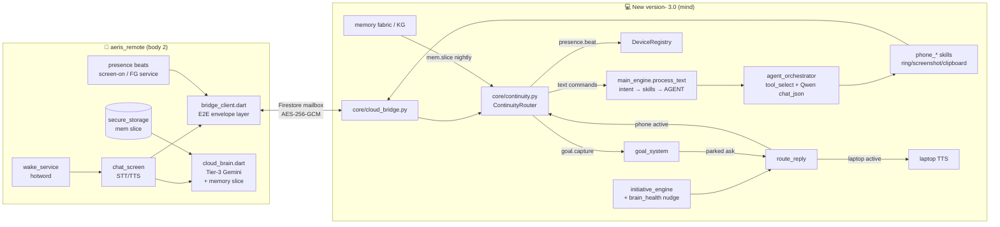
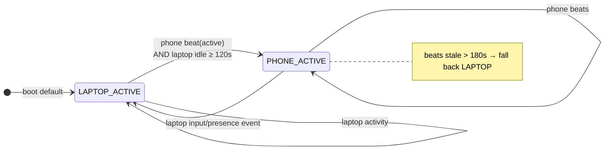
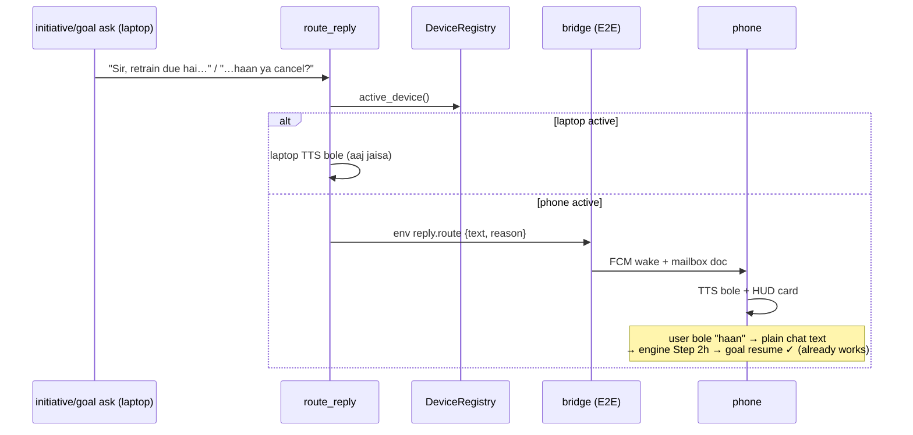
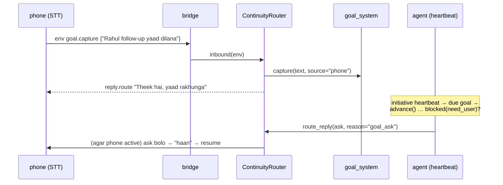
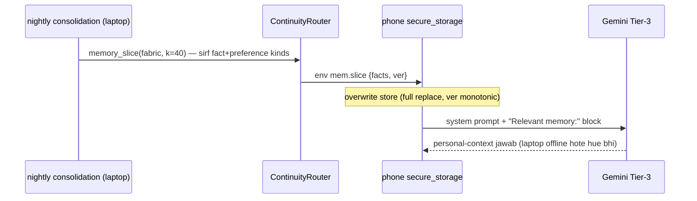

# AERIS Continuity v1 — Ek Mind, Do Body (THE next big plan)

*2026-07-19. Ye P2 ("Continuity") ka full redesign + LLD hai, aaj ke v2.1
agentic layer ke upar. Blueprint ka P2 draft (07-13) agent-less duniya mein
likha gaya tha; tab se laptop ko live agentic brain mil chuka hai
(docs/INTELLIGENCE_SYSTEM.md §8) — is doc mein wahi design us reality se
re-based hai, aur implementation phases yahin se drive honge.*

## 0. Vision (ek line)

**Laptop = mind** (brain, agent, goals, memory). **Phone = doosri body**
(voice, sensors, presence). **Bridge = spinal cord** (E2E AES-GCM, Firebase
relay — already live). Continuity layer wo nervous system hai jo decide
karta hai: *kaunsi body active hai, jawab kahan bole, goal kahan capture ho,
yaadein kahan sync hon.*

## 1. Aaj kya sach hai (as-built, verified from code)

| Piece | Status | Evidence |
|---|---|---|
| E2E bridge (Firestore mailbox, AES-GCM, QR pair) | ✅ LIVE | `core/cloud_bridge.py` |
| Phone text → **full engine** (GUI mode) | ✅ already wired | `main_engine.py:280` `set_engine_hook(self.process_text)` |
| Phone text → agent (multistep fallback) | ✅ **free ride via engine hook** — aaj v2.1 ne diya | `_fallback` → `agent.run` |
| Phone "haan" → parked goal resume | ✅ works (same engine path, Step 2h) | `main_engine` confirm-answer |
| Phone-action tools (ring/battery/screenshot/clipboard) | ✅ skills bane hain — agent inhe chain kar sakta hai | `skills/phone_*.py` |
| Headless bridge (BRIDGE.bat) | ⚠ lightweight keyword router only | `run_bridge.py` |
| **Reply routing** (jawab active body pe) | ❌ MISSING — initiative/parked asks hamesha laptop TTS pe | `_speak()` |
| **Presence arbitration** (kaunsi body active) | ❌ MISSING | — |
| **Typed envelopes** (goal.capture, presence.beat…) | ❌ MISSING — sirf plain text | bridge payload |
| **Memory slice on phone** (Gemini Tier-3 mein personal facts) | ❌ MISSING | `cloud_brain.dart` |

**Insight jo plan badal deta hai:** P2 draft ka aadha kaam (phone→brain,
phone→agent, phone confirm) v2.1 ke engine-hook ke through **muft mein ho
chuka**. Bacha hua kaam teen cheezein hain: **presence, routing, memory** —
aur unka phone-side counterpart.

## 2. System design — components



## 3. Envelope schema v1 (LLD)

**Back-compat pehle:** purana phone app plain `{"type":"chat","text":...}`
bhejta rahega — wo aaj ki tarah seedha engine mein jayega. Envelope NAYE
kinds ke liye hai, aur existing message ke andar ride karta hai:
`{"type": "event", "extra": {"env": {...}}}` — jo side envelope nahi
samajhta wo unknown event drop kar deta hai. **Naya transport nahi,
naya top-level type nahi.**

```jsonc
// extra.env =
{
  "v": 1,
  "kind": "presence.beat | goal.capture | reply.route | mem.slice | mem.request",
  "id": "c_<8 hex>",          // dedupe (LRU 128 ids per side)
  "origin": "phone" | "laptop",
  "ts": 1784145600.0,          // sender wall-clock
  "ttl_s": 120,                // is se purana → silent drop
  "payload": { }               // kind-specific ↓
}
```

| kind | direction | payload | action on receive |
|---|---|---|---|
| `presence.beat` | dono | `{"state": "active"\|"idle"\|"away"}` | `DeviceRegistry.beat(origin, state, ts)` |
| `goal.capture` | phone→laptop | `{"text": str}` | `goal_system.capture(text, source="phone")` + ack route |
| `reply.route` | laptop→phone | `{"text": str, "reason": "initiative"\|"goal_ask"\|"reply"}` | phone TTS bole + HUD dikhaye |
| `mem.slice` | laptop→phone | `{"facts": {k: v}, "ver": int}` | secure_storage overwrite (full replace) |
| `mem.request` | phone→laptop | `{}` | fresh mem.slice bhejo |

## 4. DeviceRegistry — presence arbitration (LLD)



Rules (laptop authoritative, pure logic — injectable clock):
1. Har side ka last beat (state, ts) store hota hai.
2. `active_device()` = jiska sabse recent **active** beat hai; tie ya dono
   stale → **laptop** (TTS wahan hamesha available; spam-safe default).
   *P2 draft mein tie→phone tha; badla — laptop par user ke saamne bolna
   zyada reliable hai, phone push miss ho sakta hai.*
3. Laptop beats khud generate karta hai: engine `process_text` par (user ne
   laptop use kiya = active) + presence_journal idle transitions.
4. Phone beats: FG service 60s + screen-on/unlock events (piggyback on
   existing presence doc writes — extra Firestore cost ~0).

## 5. Sequence diagrams (LLD)

### 5a. Proactive ask sahi body pe (THE missing piece)



### 5b. Phone-spoken goal (P2 flow, ab agent ke saath)



### 5c. Memory slice → phone ka Gemini



## 6. Module specs

### Laptop — `core/continuity.py` (naya; pure, injectable, fast-lane testable)

```python
@dataclass Envelope: v, kind, id, origin, ts, ttl_s, payload
    to_extra() -> dict; from_extra(d) -> Envelope|None   # schema-tolerant

class DeviceRegistry:
    beat(device, state, ts=None); active_device(now=None) -> "laptop"|"phone"
    snapshot() -> dict                                    # /mind + tests

class ContinuityRouter:
    def __init__(send_fn, goal_store, registry, speak_fn)  # sab injected
    outbound(kind, payload) -> Envelope                    # id + dedupe reg
    inbound(env_dict) -> Optional[str]      # dispatch table §3; dedupe+TTL
    route_reply(text, reason) -> "laptop"|"phone"          # §5a decision

def memory_slice(k=40) -> dict            # KG fact+preference triples only
get_router() -> ContinuityRouter          # singleton, lazily wired
```

### Laptop — integration points (chhote, surgical)

| File | Change |
|---|---|
| `core/cloud_bridge.py` | inbound: `extra.env` ho to `continuity.inbound()` (engine se pehle); outbound helper `send_envelope(env)`; phone presence doc writes → `registry.beat("phone", ...)` |
| `core/main_engine.py` | `process_text` entry par `registry.beat("laptop","active")`; `_surface_initiatives`/parked-ask speak path → `route_reply` |
| `run_bridge.py` | headless mode mein bhi continuity inbound (goal capture + presence chale, brain bhale lightweight ho) |
| `core/memory_consolidation.py` | nightly ke baad `mem.slice` push (best-effort) |

### Phone — `aeris_remote/lib` (Dart)

| File | Change |
|---|---|
| `bridge_client.dart` | `sendEnvelope(kind, payload)` + inbound `extra.env` parse → dispatcher; dedupe LRU |
| `wake_service.dart` / FG service | 60s presence.beat(active/idle) + screen-on beat |
| `chat_screen.dart` | `reply.route` → TTS + HUD card; goal-regex (Dart port of `_CAPTURE_RE`) → goal.capture envelope (baaki text aaj jaisa chat) |
| `cloud_brain.dart` | secure_storage se mem slice → "Relevant memory:" block in system prompt |
| `assistant_settings.dart` | "Continuity" section: presence toggle, mem-slice view/clear (privacy) |

## 7. Privacy + safety rails

- Mem slice mein **sirf** KG `fact`/`preference` triples — episodic chat,
  screenshots, ledger **kabhi nahi**. Phone par secure_storage, settings se
  ek-tap clear.
- Envelopes usi E2E AES-GCM se — Firebase ko ciphertext hi dikhta hai.
- TTL + dedupe: replay/stale attacks structurally dead (`_MAX_MSG_AGE_S`
  ke upar per-envelope ttl).
- Routing sirf **bolne ki jagah** decide karta hai — authority nahi.
  Autonomy Ladder/TrustGate/confirm flow untouched; "haan" resume wahi
  purana governed path hai.
- Registry fail/unknown → laptop default (fail-safe, fail-quiet).

## 8. Implementation phases (har ek shippable + gated)

| Phase | Kaam | Status (2026-07-19) |
|---|---|---|
| **C1** | `core/continuity.py` full (Envelope/Registry/Router/mem_slice) + fast-lane tests | ✅ BUILT — 25 tests green |
| **C2** | Laptop wiring: bridge inbound/outbound, engine beats (`process_text(source=)`), route_reply on initiatives, engine-hook phone source | ✅ BUILT |
| **C3** | Phone Dart: `lib/continuity.dart` + beats (resume/60s/pause) + reply.route TTS/HUD + goal regex → goal.capture | ✅ BUILT — flutter analyze clean |
| **C4** | Memory slice: KG export + nightly push (consolidation hook) + on-connect `mem.request` + Gemini "Relevant memory" injection | ✅ BUILT |
| **C5** | Polish: `continuity_status` skill (voice), docs, corpus/hash refresh (`14c9be45…`) | ✅ BUILT |
| **C6** (later) | P3 phone-as-sensor (notifications/calendar/location envelopes) | ⏳ next |

**Live-verification checklist (user, after APK rebuild + AERIS restart):**
1. Phone kholo → laptop par voice se "continuity status" → "active body phone" bolna chahiye.
2. Phone se "Rahul ko follow up karna hai" → ack aaye, laptop /mind mein goal dikhe.
3. Phone jeb mein (app open), laptop idle 2+ min → retrain-due/goal nudge PHONE par bole.
4. Laptop band karke phone par koi personal sawal (Gemini) → synced fact use ho.

## 9. Kyun yehi "next big" hai (aur kya nahi kar rahe)

- **Leverage max hai**: v2.1 ke baad phone ko brain+agent already milta
  hai; sirf presence+routing+memory jodne se poora "ek mind, do body"
  experience unlock hota hai — naya transport, naya model, naya OAuth kuch
  nahi.
- **Not doing now**: P8 web-agent, P9 LoRA personality (P5 gate ke peeche),
  UPI (user-skipped), mirroring tuning. P3 sensors C6 mein hi aayenge —
  pehle spinal cord, phir naye sense organs.
